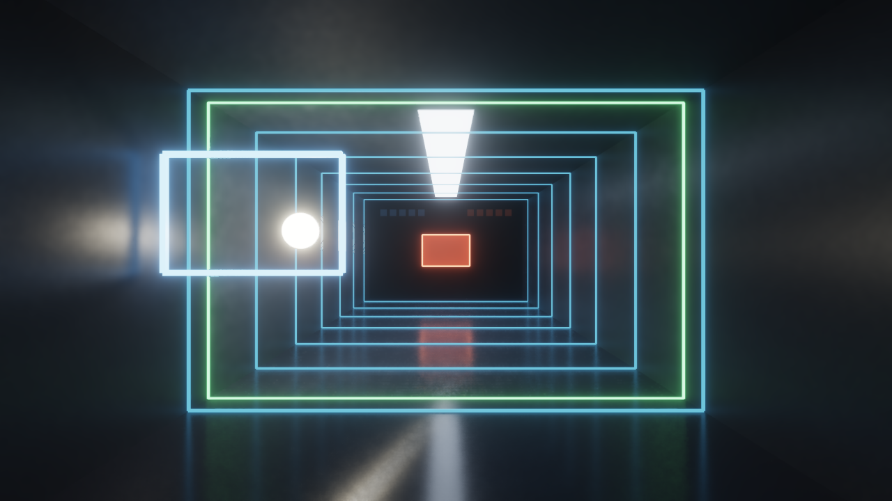

# AstralEngine

A modular C++20 game engine built as a set of libraries, with an App layer on top for writing games.

```cpp
#include <astral/astral.hpp>
using namespace astral;

struct Spin { float speed = 1.0f; };

class SpinSystem final : public System {
    void update(Context& ctx) override {
        ctx.world.each<Transform, const Spin>([&](Transform& t, const Spin& s) {
            t.rotation = Quat::from_axis_angle({0, 1, 0}, s.speed * ctx.time.delta) * t.rotation;
        });
    }
};

class MyGame final : public Game {
    void on_start(Context& ctx) override {
        const MaterialHandle red = ctx.create_material({.base_color = {0.9f, 0.2f, 0.2f, 1}});
        ctx.world.create(Transform{}, MeshRenderer{ctx.meshes.cube, red}, Spin{2.0f});
        ctx.add_system<SpinSystem>(Phase::Update);
    }
};

int main() { return App({.title = "My Game"}).run<MyGame>(); }
```

Games are written with components (data) and systems (logic) on top of `Astral::App`; every lower
module (core, gpu, platform, world, render) is also usable directly as a plain library.

## Status

Version 0.17.0, pre-1.0: APIs still change. Detailed, honest per-module state (strengths, weaknesses, known
failures, measurements): [docs/status.md](docs/status.md). Plans: [docs/roadmap.md](docs/roadmap.md).

| Area | State |
|---|---|
| Core, ECS (`Astral::World`), App shell, parallel system scheduler | Working, broadly tested |
| Rendering: hybrid deferred + ray tracing (RT shadows/reflections, area lights, DDGI, ReSTIR DI, denoiser, TAA, bloom), SDF, decals, advanced PBR, progressive path tracer | Working; heavy on mid-range RT GPUs (no render scale yet), no spot lights, no depth of field |
| `.ashader` / `.material` (surface, sky, post, particle, volume; shading models), SPIR-V disk cache | Working |
| Physics (Jolt v5.7.0): bodies, shapes, joints incl. SixDOF/motors/breaking, queries, wind/water fields, character | Working |
| Luau scripting: sandbox, hot reload, generated `astral.d.luau` / API docs, `astral-luau-check` | Working |
| Assets: glTF/GLB (no skins/animation), cook, `.apak` packages, hot reload; scenes, prefabs, streamed worlds, terrain tiles | Working |
| Audio (miniaudio, buses, 3D) | Basic: no filters, reverb or occlusion |
| Editor (`examples/world_editor`) | Early: no project management, real Play-in-Editor or export |
| Animation, vehicles, navigation, networking | Not started |

Tests: Debug and Release with warnings-as-errors pass on Windows/MSVC except 3 hardware golden-image tests that
fail on the reference PC (RTX 3060) — see [docs/status.md](docs/status.md).


*Screenshots are older captures (M3.5–M7) and will be replaced when the examples are rebuilt.*

The same room as data: [`examples/asset_viewer/assets/showcase.scene`](examples/asset_viewer/assets/showcase.scene)
places three prefabs (room, mirror pedestal, box ×3 with per-instance overrides) — edit the files while
`asset_viewer` runs and the room updates.


## Examples

| Example | Shows |
|---|---|
| `hello_headless`, `hello_triangle`, `spinning_cubes` | Smallest starting points |
| `pong` | A complete small game: Luau rules, save slots, gamepad |
| [`physics_showcase`](examples/physics_showcase/README.md) | Rigid bodies, joints, surfaces, water and wind |
| [`lighting_showcase`](examples/lighting_showcase/README.md) | Ray-traced room, SDF shapes, many lights (ReSTIR), path tracer |
| [`materials_showcase`](examples/materials_showcase/README.md) | PBR shading models, decals, `.material` workflow, `.ashader` gallery |
| [`world_showcase`](examples/world_showcase/README.md) | Streamed open world, floating origin, terrain |
| [`vfx_showcase`](examples/vfx_showcase/README.md) | Atmosphere, fog, smoke, GPU particles, VFX and audio from Luau |
| [`asset_viewer`](examples/asset_viewer/README.md) | glTF models and scenes, cook and package |
| `world_editor` | Early standalone editor |

## First game: 3D Pong

`examples/pong` is the smallest complete game on the engine, written as three feature packages: the rules
(paddles, AI, ball, scoring) are Luau scripts you can edit while it runs, two small C++ features add the score
lights and the sound, and a scene with prefabs describes everything you see. Keep the ball in the tunnel; where
it hits your paddle bends its path. `pong --demo` lets the AI play both sides.



## Build

Requires CMake ≥ 3.24 (including 4.x), Ninja, a C++20 compiler (GCC 13, Clang 18, MSVC 2022/2026) and the Vulkan SDK
(headers, loader, `glslc`). SDL3, VMA, Jolt, glslang, Luau, Dear ImGui, miniaudio, stb, zstd and bc7enc are fetched automatically.

```sh
cmake --preset debug
cmake --build --preset debug
ctest --preset debug
```

On Windows, open an **x64 Native Tools Command Prompt** (or run `vcvars64.bat`),
then run `cmake --preset debug && cmake --build --preset debug && ctest --preset debug`.

Presets: `debug`, `release`, `tsan` (ThreadSanitizer), `asan`. Games are written in C++ and/or Luau: see
[docs/guides/writing-a-game.md](docs/guides/writing-a-game.md) and, for AI agents, [AGENTS.md](AGENTS.md).

## Shipping a game

```cmake
astral_add_game(arena SOURCES src/main.cpp ASSETS content)   # exe reads content/ while developing
```

`cmake --build build --target arena_package` cooks the assets (BC7/BC5 textures, binary scenes; only
what changed) and stages `build/packages/arena/` = `arena` + `arena.apak`, ready to copy anywhere.
The packaged showcase below renders the same image as the loose files:


## Use in your game

```sh
cmake --install build/release --prefix <install-dir>
```

```cmake
find_package(Astral 0.17 CONFIG REQUIRED COMPONENTS App)
astral_add_game(mygame SOURCES src/main.cpp ASSETS assets)   # or link Astral::Core, Astral::World, ... as plain libraries
```

Or add the repo with `add_subdirectory` / `FetchContent` and link the same targets.

## Start a game

`templates/blank` is a complete small game: feature packages (C++ data + Luau rules), a headless test, the standard `main`
(`--capture`, `--script-api`), packaging and the feature-boundary check. Copy the folder, rename `blank`, build:

```sh
cp -r templates/blank mygame && cmake -S mygame -B mygame/build -DCMAKE_PREFIX_PATH=<engine install> && cmake --build mygame/build
```

Every program in `examples/` is built the same way.

## Layout

```
modules/<name>/include/astral/<name>/   public API
modules/<name>/src/                     private implementation
modules/<name>/tests/                   unit tests
templates/blank/                         a blank game: copy it to start (features, Luau, tests, packaging)
examples/                               runnable games built like the template
features/                               shared feature packages (copied into games)
tests/consumer/                         find_package smoke test against the installed SDK
tools/                                  command line tools and checks (docs/tools.md)
cmake/                                  build helpers
```

## Rules

- Dependencies point one way: `core → shader/gpu/platform → world/physics/audio/script/render/assets → app → editor` ([docs/architecture.md](docs/architecture.md)).
- No singletons, no global mutable state — pass dependencies in.
- No third-party types in public headers.
- Resources are referenced by generational `Handle<T>`, not raw pointers.

## Docs

See [docs/](docs/README.md) (Turkish): status, roadmap, architecture, process, module docs, guides, decision records.

## License

MIT
