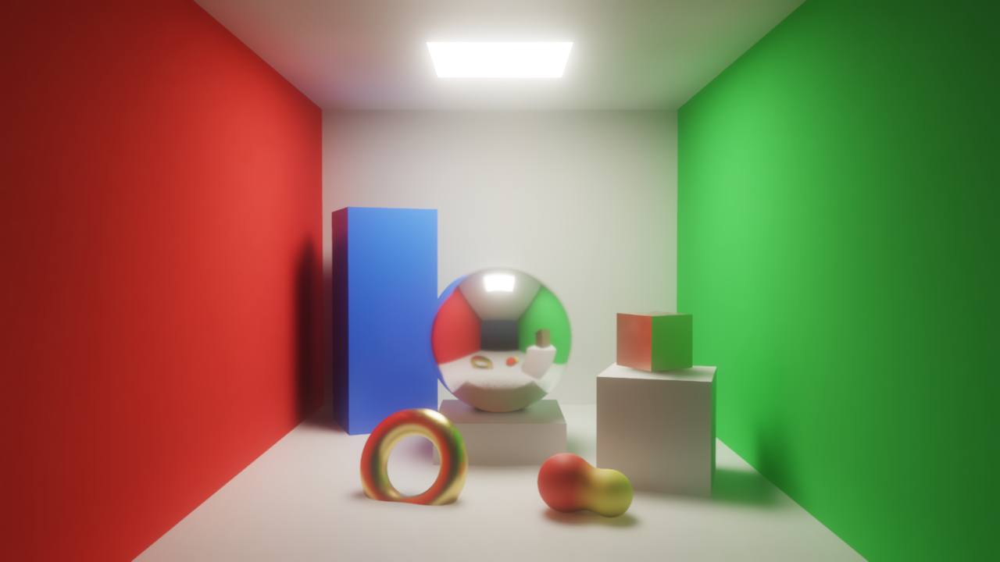
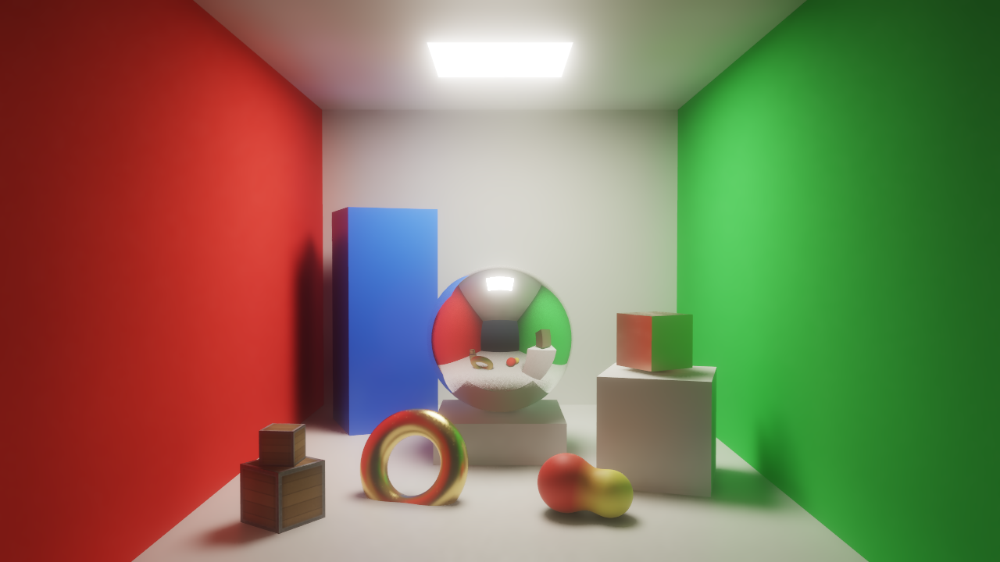

# AstralEngine

A modular C++20 game engine built as a set of libraries, with an App layer on top for writing games.

```cpp
#include <astral/astral.hpp>
using namespace astral;

struct Spin { float speed = 1.0f; };

class SpinSystem final : public System {
    void update(Context& ctx) override {
        ctx.world.each<Transform, const Spin>([&](Transform& t, const Spin& s) {
            t.rotation = Quat::from_axis_angle({0, 1, 0}, s.speed * ctx.time.delta) * t.rotation;
        });
    }
};

class MyGame final : public Game {
    void on_start(Context& ctx) override {
        const MaterialHandle red = ctx.create_material({.base_color = {0.9f, 0.2f, 0.2f, 1}});
        ctx.world.create(Transform{}, MeshRenderer{ctx.meshes.cube, red}, Spin{2.0f});
        ctx.add_system<SpinSystem>(Phase::Update);
    }
};

int main() { return App({.title = "My Game"}).run<MyGame>(); }
```

Games are written with components (data) and systems (logic) on top of `Astral::App`; every lower
module (core, gpu, platform, world, render) is also usable directly as a plain library.

## Status

| Module | Status |
|---|---|
| `Astral::Core` — log, handles, clock, jobs | ✅ M0 |
| `Astral::Gpu` (Vulkan 1.3 RHI), `Astral::Platform` (SDL3) | ✅ M1 |
| `Astral::World` (own ECS), `Astral::Render` (forward), `Astral::App` | ✅ M2 |
| `RenderGraph`, hybrid deferred renderer (meshes + SDF, PBR, shadows) | ✅ M3 |
| `Astral::Physics` (Jolt: bodies, raycast, contacts, character controller) | ✅ M4 |
| Ray-traced lighting: RT shadows, area lights, DDGI + near-field RTGI, RT reflections, denoiser, TAA, bloom | ✅ M3.5 |
| ECS: change detection, filtered queries, events, reflection, JSON save/load | ✅ M5a |
| `Astral::Assets`: glTF/GLB, textured PBR materials, async loading, hot reload | ✅ M5b |
| Scenes and prefabs: stable ids, field-level overrides, nested prefabs/variants, live reload | ✅ M5c |
| Packaging: `astral-cook` (BC7/BC5 textures, binary scenes, incremental), `.apak` (zstd), `astral_add_game` | ✅ M6 |
| First game: 3D Pong (`examples/pong`) — everything else in scene/prefab files (since M11: feature packages, rules in Luau) | ✅ M7 |
| Developer tools: profiler (CPU + per-pass GPU), debug draw, Dear ImGui panel (F1, reflection inspector), SDF text/HUD, `Astral::Audio` (miniaudio, 3D, `AudioSource`) | ✅ M8 (golden image tests: `ctest -L golden`) |
| World & map system (UE5 World Partition-style: `.world`, one file per entity, cell streaming, data layers, floating origin; `examples/open_world`) | ✅ M9 |
| `.ashader` shader language (gdshader-like, GLSL body) + `.material` files with parents: foliage, glass, lava, hologram, sky and post shaders, hot reload, same look in raster and ray tracing (`examples/shader_showcase`) | ✅ M10 |
| Modular game code (feature packages, boundary checks) + Luau scripting (reflection-bound components, systems, behaviours, events, hot reload, generated API docs), input actions; Pong's rules in Luau | ✅ M11 |
| `templates/blank` (a new game in one folder) + the standard game shell (`run_game`); every example rebuilt on it | ✅ M11 |
| Physics: collision layers, query filters, shape casts, convex hull / mesh / height field / compound shapes, joints, wind and water fields (same functions on the GPU), buoyancy, drag, lift, trigger events; `examples/physics_playground` | ✅ M12 |
| Advanced PBR, deferred decals and progressive path tracer reference | ✅ M13 |
| Module refactor, layer and size checks, portable golden test suite | ✅ M13.5 |
| Parallel system scheduling and transforms, worker-side cell I/O, runtime benchmarks | ✅ M13.6 |
| Revalidate the baseline and inventory public capabilities ([report](docs/status/f0-verification-report.md), [matrix](docs/status/capabilities.md)) | ✅ F0 |
| Gameplay API, unified discovery, identity/schema contracts and deterministic physics step queue ([ADR-0034](docs/decisions/0034-gameplay-api-and-physics-step-contract.md)) | ✅ F1 |
| Standalone AI-assisted desktop editor core (`Astral::Editor_core`, `Astral::Editor`, `examples/world_editor`, [ADR-0035](docs/decisions/0035-standalone-ai-assisted-editor-core.md)) | ✅ E0 |
| World authoring & Level Instances (`.world`/`.ent` editing, `LevelInstanceMember`/`CrossCellRef`, Edit-in-Context vs Instance Override, data-driven placement + `IHeightSampler`, [ADR-0036](docs/decisions/0036-world-authoring-and-level-instances.md)) | ✅ E1 |
| AI-First Native Editor (`AstralEditor`, Focus/Advanced workspaces, live offscreen 3D viewport, picking/gizmos, isolated Play mode, ManualSave + autosave, async 7-state AI review + 3D Before/After + Codex CLI adapter, [ADR-0037](docs/decisions/0037-ai-first-native-editor-v2.md), [Guide](docs/editor/README.md)) | ✅ E2 |
| Physics API v2 (`P0`), atmosphere, terrain, water, weather, destruction, animation, vehicles, deformables and co-op | 🔜 P0 · [Roadmap v5](docs/roadmap.md) |



The same room as data: [`examples/scene_viewer/assets/showcase.scene`](examples/scene_viewer/assets/showcase.scene)
places three prefabs (room, mirror pedestal, box ×3 with per-instance overrides) — edit the files while
`scene_viewer` runs and the room updates.


## First game: 3D Pong

`examples/pong` is the smallest complete game on the engine, written as three feature packages: the rules
(paddles, AI, ball, scoring) are Luau scripts you can edit while it runs, two small C++ features add the score
lights and the sound, and a scene with prefabs describes everything you see. Keep the ball in the tunnel; where
it hits your paddle bends its path. `pong --demo` lets the AI play both sides.


## Build

Requires CMake ≥ 3.24 (including 4.x), Ninja, a C++20 compiler (GCC 13, Clang 18, MSVC 2022/2026) and the Vulkan SDK
(headers, loader, `glslc`). SDL3, VMA, Jolt, glslang, Luau, Dear ImGui, miniaudio, stb, zstd and bc7enc are fetched automatically.

```sh
cmake --preset debug
cmake --build --preset debug
ctest --preset debug
```

On Windows, open an **x64 Native Tools Command Prompt** (or run `vcvars64.bat`),
then run `cmake --preset debug && cmake --build --preset debug && ctest --preset debug`.

Presets: `debug`, `release`, `tsan` (ThreadSanitizer), `asan`. Games are written in C++ and/or Luau: see
[docs/guides/writing-a-game.md](docs/guides/writing-a-game.md) and, for AI agents, [AGENTS.md](AGENTS.md).

## Shipping a game

```cmake
astral_add_game(arena SOURCES src/main.cpp ASSETS content)   # exe reads content/ while developing
```

`cmake --build build --target arena_package` cooks the assets (BC7/BC5 textures, binary scenes; only
what changed) and stages `build/packages/arena/` = `arena` + `arena.apak`, ready to copy anywhere.
The packaged showcase below renders the same image as the loose files:



## Use in your game

```sh
cmake --install build/release --prefix <install-dir>
```

```cmake
find_package(Astral 0.17 CONFIG REQUIRED COMPONENTS App)
astral_add_game(mygame SOURCES src/main.cpp ASSETS assets)   # or link Astral::Core, Astral::World, ... as plain libraries
```

Or add the repo with `add_subdirectory` / `FetchContent` and link the same targets.

## Start a game

`templates/blank` is a complete small game: feature packages (C++ data + Luau rules), a headless test, the standard `main`
(`--capture`, `--script-api`), packaging and the feature-boundary check. Copy the folder, rename `blank`, build:

```sh
cp -r templates/blank mygame && cmake -S mygame -B mygame/build -DCMAKE_PREFIX_PATH=<engine install> && cmake --build mygame/build
```

Every program in `examples/` is built the same way.

## Layout

```
modules/<name>/include/astral/<name>/   public API
modules/<name>/src/                     private implementation
modules/<name>/tests/                   unit tests
templates/blank/                         a blank game: copy it to start (features, Luau, tests, packaging)
examples/                               runnable games built like the template
tests/consumer/                         find_package smoke test
cmake/                                  build helpers
```

## Rules

- Dependencies point one way: `core → platform/gpu → render/world/physics/assets → app`.
- No singletons, no global mutable state — pass dependencies in.
- No third-party types in public headers.
- Resources are referenced by generational `Handle<T>`, not raw pointers.

## Docs

See [docs/](docs/README.md) (Turkish): architecture, roadmap, module docs, decision records.

## License

MIT
