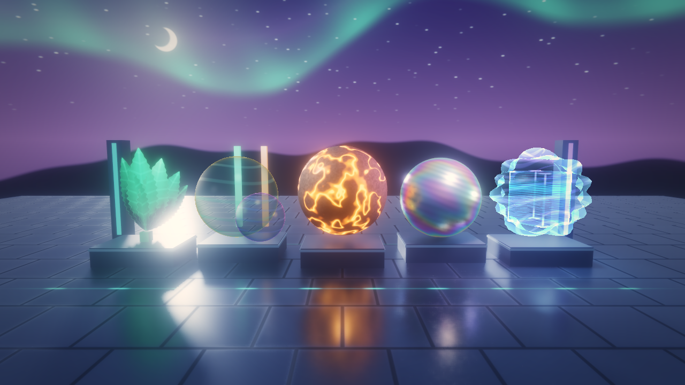

# Shader ve materyal yazmak (kod bilmeyen için)

Bu rehber, `examples/shader_showcase` örneğinin nasıl çalıştığını anlatır. Örneği açıp bir
`.ashader` veya `.material` dosyasını kaydettiğinde değişikliği oyun çalışırken görebilirsin.
Dilin tüm söz dizimi, yerleşik değişkenleri (built-in'ler), mimarisi ve gelecek yol haritası için
**[Astral Shader Dili (`.ashader`) Tam Referans Kılavuzu](ashader-language.md)** dokümanına bakabilirsin.

WASD ile hareket et, Q/E ile alçal ve yüksel, Shift ile hızlan. Sağ fare tuşunu basılı tutarak etrafa bak.
Örneği `--raster` ile başlatırsan ışın izleme kapalı çalışır. `--capture out.ppm` ile bir kare kaydedebilirsin.



## İki dosya türü

| Dosya | Ne işe yarar | Örnek |
|---|---|---|
| `.ashader` | Bir yüzeyin **nasıl görüneceğinin tarifi**. Parlak mı, şeffaf mı, akıyor mu, sallanıyor mu | `shaders/lava.ashader` |
| `.material` | O tarife **verdiğin değerler**: renk, parlaklık, hız… | `materials/glass_blue.material` |

Bir shader'dan istediğin kadar materyal çıkar. Camın mavi hâli, camın kendisini kopyalamaz; sadece farkı yazar:

```json
{ "format": "astral.material", "version": 1,
  "parent": "materials/glass.material",
  "values": { "tint": [0.19, 0.34, 1.0], "edge_tint": [0.82, 0.32, 1.0], "opacity": 0.22 } }
```

## Örnekte neler var

| Materyal | Nasıl yapıldı |
|---|---|
| **Biyolüminesan yaprak** (`leaf`) | `alpha_test` tırtıklı yaprak biçimini keser. Damarlar nabız gibi parlar, rüzgâr `vertex()` ile ucu büker |
| **Halkalı cam** (`glass`, `glass_blue`) | `blend_mix` ile arkadaki ışıklar görünür. Fresnel kenarda rengi ve opaklığı artırır |
| **Lav** (`lava`) | Üç boyutlu gürültü, kürenin dikişinde kesinti olmadan akan sıcak kanallar üretir |
| **İnce film alaşımı** (`alloy`) | Fırçalı metalde renk ve parlaklık bakış açısıyla değişir |
| **Hologram ve plazma** (`hologram`, `plasma_shell`) | `blend_add` ile tarama çizgileri, köşe ışıkları ve hareketli plazma katmanları üst üste gelir. Plazma dalgası silüeti de deforme eder |
| **Galeri zemini** (`gallery_floor`) | Dünya koordinatlarından dikişli paneller ve gömülü ışık şeritleri üretir |
| **Gece gökyüzü** (`dusk_sky`) | `shader_type sky` ile yıldızlar, hilal, dağ silüeti ve hareketli kutup ışıkları çizilir |
| **Son işlem** (`vignette`) | `shader_type post` ile renk düzenlemesi, kenar kararması ve hafif renk ayrışması uygulanır |

## Kendi materyalini yapmak

1. `assets/shaders/` içine bir `.ashader` yaz (en kolayı örneklerden birini kopyalayıp değiştirmek).
2. `assets/materials/` içine `.material` yaz; `"shader"` alanına shader yolunu ver.
3. `assets/showcase.scene` içindeki bir nesnenin `astral::PrimitiveMesh.material_file` alanına
   materyal yolunu ver. Sahne dosyası nesnelerin yerleşimini, kamerayı, güneşi ve ortam ışığını da içerir.

Gökyüzü ve ekran efektinin materyal yolları ile bloom şiddeti
`assets/features/showcase_look/feature.json` dosyasındadır. Örnek, bu materyalleri
`ctx.materials().load_material(path)` ile yükleyip gökyüzünü `ctx.sky`, ekran efektini `ctx.post` üzerinden bağlar.
Sahne veya özellik ayarlarını değiştirdiğinde örneği yeniden başlat.

Bir şey yanlışsa oyun çökmez: hata `dosya:satır` ile loglanır, ekranda **son çalışan sürüm** kalır. Satır numarası
doğrudan `.ashader` dosyanın satırıdır.

## Canlı ayarlama

F1 → Windows → **Materials**: her materyal için kaydırıcılar ve renk seçiciler (shader'daki `range(...)` ve
`source_color` ipuçlarından otomatik çıkar). Değişiklik anında görünür ama dosyaya yazılmaz; beğendiğin
değeri `.material` dosyasına kendin yaz.

## Raster ve ışın izleme aynı görünür mü?

İki modda da aynı malzemelerle galeri gezilebilir. Işın izleme açıkken lav ve alaşımın zemindeki
yansımalarını karşılaştır. Cam, hologram ve plazma saydamlık geçişinde çizilir ve RT yansımalarına
girmez. RT yansıması ve dolaylı ışık hesabı `vertex()` deformasyonunu ve alfa kesimini hesaba katmaz.
