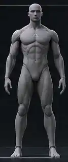

# ATLAS v1 — Astral Standard Mannequin

**Durum:** Görsel yön ve teknik hedefler belirlenmiş; mesh, rig, animation clips ve physics asset henüz üretilmedi. [Astral Motion](astral-motion-architecture.md) ile birlikte geliştirilir.



Görsel: 25 Kasım 2026, sohbet için üretilmiş ATLAS konsept paftasından doğrudan alınmış ön görünüş (134×317 WebP). Pafta render edilmiş bir konsepttir, gerçek mesh/rig/LOD kanıtı değildir. Tam 1536×1024 PNG mevcut sohbet çıktısında; bu branch'te yalnız küçük ön görünüş saklanır. Görsel üzerindeki ölçü/etiketler teknik doğrulama yerine geçmez.

## Tasarım

Klasik, sade ve premium humanoid mannequin; mat grafit sentetik yüzey, açık gri eklem detayları, nötr yüz, atletik ama abartısız anatomi, küçük geometrik Astral amblemi. Zırh, neon, kablo, cyberpunk yok. Tek karakter, simetrik, çıplak anatomik detay yerine nötr mannequin yüzeyi; beş ayrı parmak, düzgün ayak, deformasyon için temiz eklem topolojisi. 

| Parametre | Hedef |
|---|---|
| Boy / kütle | 1.80m / 80kg nominal fizik profili |
| Unit / up / forward | metre / +Y / -Z engine space |
| Root origin | ayaklar arasındaki zemin merkezi |
| Rest pose | simetrik A-pose, kollar gövdeden ayrı |
| LOD0–3 | yaklaşık 68k / 34k / 17k / 8.5k render triangle hedefi; ölçümle değişebilir |
| Material | matte neutral PBR, UV, base color/normal/roughness/metallic; ışık gömülmez |
| Source/runtime | .blend / glTF 2.0 GLB + cooked Astral data |
| Skeleton | tek sürümlü humanoid rig contract, LOD mapping |

A-pose açıları konsept çiziminde yaklaşık 15°, Tripo denemesinde düşeyden 30° olarak tarif edildi. Görseli ölçü standardı yapmıyoruz: 30° düşeyden başlangıç önerisi; kesin joint rest TRS ve el yönü Blender fixture ile dondurulacak. Poligon üretici face_limit ile üçgen render bütçesi aynı metrik değildir; export sonrası sayılır.

## Rig standardı (öneri)

root → pelvis → spine_01/02/03 → neck → head; bilateral clavicle, upperarm, lowerarm, hand; thigh, calf, foot, ball; thumb/index/middle/ring/pinky üç eklemli zincirler uygun anatomiyle; twist bones gerektiğinde. _l/_r suffix; bone semantic mapping names'den bağımsız IDs ile. Deform joints, authoring controls, twist/helper ve sockets ayrı kategoriler; exact bone count ve joint orientations rig ADR/fixture ile kesinleşir. No per-bone ECS entity. IK chains for arms/legs, elbow/knee pole targets, root/pelvis control, hand/foot contacts. Sockets weapon_r, weapon_l, camera, head, back, hip_l, hip_r; bind bone + local offset, runtime semantic lookup. Weapon socket'ın görsel işaretinden joint çıkarmak yerine gerçek rig koordinatı kullan.

Fizik profili: locomotion capsule, ayrı ragdoll capsules/convex bodies, limb mass distribution toplam 80 kg, center of mass/inertia, collision groups, joint limits and motor strengths. Ölçülmüş fizik parametreleri yok; Blender ölçümü, Jolt calibration ve transition tests ile belirle. 
Standard/Physics/IK/Crowd aynı rig'in farklı runtime profilleri. Athletic/Slim mesh variations daha sonra; retarget/LOD remap testleri.

## Asset package (önerilen, henüz mevcut değil)

```text
assets/characters/atlas/
  source/atlas.blend
  models/atlas.glb
  models/atlas_lod1.glb
  models/atlas_lod2.glb
  models/atlas_lod3.glb
  skeleton/
  animations/
  rigs/
  physics/
  materials/
  prefabs/
  tests/
```

Fiziksel repo konumu, asset licensing ve distribution ADR ile kararlaştırılır. Ortak optional asset paketi; engine binary ve dedicated server'a zorunlu gömülmez. Source provenance, AI-generated geometry rights, motion data license, reproducible export ve exact hash metadata. 
Animation set: idle/walk/jog/run/sprint, directional/strafe/back/diagonal, start/stop/pivot/turn, jump/fall/land, grip/push/pull/carry, attack/block/dodge, stumble/fall/get-up, vehicle enter/seat/steering, sports pass/kick/dribble. In-place and root variants where appropriate. Metadata duration, units, source/license, foot contact markers, root-motion type, skeleton version. No shipped clip claims.

## Üretim akışı ve Higgsfield durumu

1. Konsept paftası → front/left/back/right ayrı tutarlı referans; perspektifsiz A-pose, no label/background mesh.
2. Tripo H3.1 Multiview (discovered model ID tripo_h3_1_multiview_to_3d), 2–4 ordered views, textured GLB/PBR; alternatif single-image or text-to-3D. Multiview maliyeti henüz hesaplanmadı.
3. Blender retopology, UV, anatomical fingers/feet, scale/origin/axis normalization, skin-ready edge loops, material/LOD audit.
4. Meshy 3d_rigging candidate on generated GLB or manual rig. Automatic rig is initial candidate only: validate weights, twist, finger chains, sockets, rest pose, skin palette; do not accept tool success as game-ready.
5. Source/cook/SDK validation; static importer currently lacks skinned animation support until AN0. CPU pose fixture can precede actual mesh.
6. character_lab + football/competitive/sword/city lab reuse, physical/visual acceptance; record logs.

**Gerçek deneme:** Higgsfield MCP tripo_3d (text-to-3D), PBR/texture on, detailed geometry/texture, face_limit 68000, count 1, auto_size false. Quote 12.5 credits. İlk istek 1024 karakter prompt limitinden reddedildi, kısaltılmış ikinci istek Private workspace free plan kredi yetersizliğinden reddedildi. Job/GLB üretilmedi, rigging yapılmadı, ücretli alternatif veya GPU kiralama başlatılmadı. Önceki konsept doğrudan provider'a yüklenmedi; text prompt kullanıldı. Yeni üretim öncesi maliyet ve hakları doğrula.

### Tekrar kullanılabilir text-to-3D prompt (1024 karakter altı)

```text
ATLAS, original Astral Engine humanoid animation mannequin. One complete full-body adult male-proportioned athletic figure, realistic restrained anatomy, smooth matte graphite gray synthetic body shell, subtle light gray articulated joint seams at shoulders, elbows, wrists, hips, knees and ankles. Simple neutral human-like bald face, closed mouth, five separated fingers per hand, anatomically correct feet. Symmetric neutral A-pose, straight legs hip-width apart, feet flat parallel, arms angled outward 30 degrees from vertical, elbows nearly straight, palms inward, fingers slightly separated. Arms not touching torso. Nominal 1.8m height. Continuous deformable mesh, classic premium industrial design, tiny triangular chest emblem. For humanoid rigging, animation retargeting and physics testing. No base.
```

Negative: multiple characters, pedestal, floor, labels, armor, neon, cables, extra/fused fingers, fused/disconnected limbs, action pose, asymmetry, baked shadows.

## Kabul kapıları

ATLAS0 concept & spec (bu doküman; actual asset pending); ATLAS1 source mesh/UV/scale + GLB validator; ATLAS2 skeleton/weights/rig & clip reference; ATLAS3 physical profile + pose/controller/IK tests; ATLAS4 LOD and cross-game consumer. Track under AN0/AN1/CH1, not new independent engine milestones. 
Geometry inspect symmetry, 5 fingers, no unintended intersections/holes, finite normals, valid UV, correct dimensions and units; weights finite/nonnegative/normalized, valid joint indices, rest bind pose matches mesh. Test extreme joint motion, foot slip, grip/socket offset, retarget, ragdoll transition, rendering and skinning parity. LOD silhouette and pose consistency, asset provenance/licensing, budget measurements and exact SHA. No model produced or test passed in this branch.
