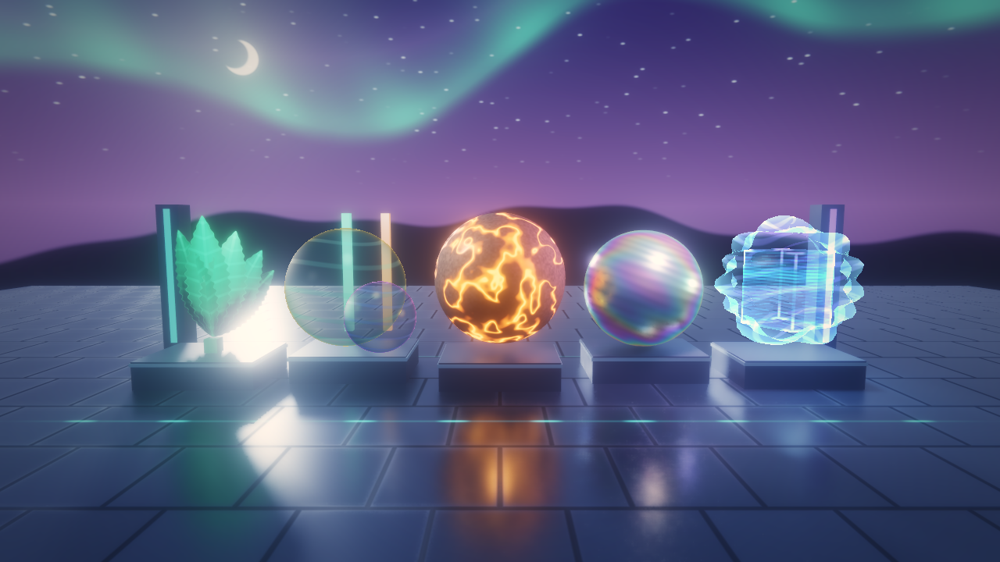

# Astral Shader Dili (`.ashader`) ve Materyal Sistemi (`.material`) — Tam Referans Kılavuzu

Bu doküman, AstralEngine'in yerleşik shader dili olan **`.ashader`** ve veri odaklı materyal sistemi **`.material`** için kapsamlı başvuru kılavuzudur. Dilin tasarım felsefesini, söz dizimini, yerleşik değişkenlerini (built-in'ler), motorun arka planda ürettiği çoklu GPU pipeline'larını (Raster G-Buffer, Gölge, Forward Şeffaflık, Hibrit Işın İzleme / Ray Tracing), canlı düzenleme iş akışını, mevcut sınırları ve gelecek yol haritasını kapsar.



---

## İçindekiler

1. [Tasarım Felsefesi ve Mimari Özeti](#1-tasarım-felsefesi-ve-mimari-özeti)
2. [Hızlı Başlangıç: İlk Shader ve Materyaliniz](#2-hızlı-başlangıç-ilk-shader-ve-materyaliniz)
3. [`.ashader` Dil Referansı](#3-ashader-dil-referansı)
   - [3.1. `shader_type` Bildirimi](#31-shader_type-bildirimi)
   - [3.2. `render_mode` Seçenekleri](#32-render_mode-seçenekleri)
   - [3.3. `uniform` Bildirimleri, Tipler ve Varsayılan Değerler](#33-uniform-bildirimleri-tipler-ve-varsayılan-değerler)
   - [3.4. `uniform` İpuçları (Hints) ve Editör Entegrasyonu](#34-uniform-ipuçları-hints-ve-editör-entegrasyonu)
   - [3.5. `varying` ile Aşamalar Arası Veri Aktarımı](#35-varying-ile-aşamalar-arası-veri-aktarımı)
   - [3.6. İsimlendirme Kuralları ve Makro İzolasyonu](#36-isimlendirme-kuralları-ve-makro-izolasyonu)
4. [Giriş Noktaları ve Yerleşik Değişkenler (Built-ins)](#4-giriş-noktaları-ve-yerleşik-değişkenler-built-ins)
   - [4.1. `shader_type surface` — `vertex()` Aşaması](#41-shader_type-surface--vertex-aşaması)
   - [4.2. `shader_type surface` — `surface()` Aşaması](#42-shader_type-surface--surface-aşaması)
   - [4.3. `shader_type sky` — `sky()` Aşaması](#43-shader_type-sky--sky-aşaması)
   - [4.4. `shader_type post` — `post()` Aşaması](#44-shader_type-post--post-aşaması)
5. [`.material` Dosya Formatı ve Kalıtım (Material Instances)](#5-material-dosya-formatı-ve-kalıtım-material-instances)
6. [Motor İçinde Nasıl Çalışır? (Derleme ve Çizim Boru Hattı)](#6-motor-içinde-nasıl-çalışır-derleme-ve-çizim-boru-hattı)
   - [6.1. Tek Kaynaktan Çoklu Pipeline Üretimi](#61-tek-kaynaktan-çoklu-pipeline-üretimi)
   - [6.2. Hibrit Işın İzleme (Ray Tracing & DDGI) Entegrasyonu](#62-hibrit-ışın-izleme-ray-tracing--ddgi-entegrasyonu)
   - [6.3. Bindless Doku ve `std430` Parametre Bloğu Düzeni](#63-bindless-doku-ve-std430-parametre-bloğu-düzeni)
   - [6.4. `#line` Eşlemesi ve Çökmesiz Hot-Reload](#64-line-eşlemesi-ve-çökmesiz-hot-reload)
7. [Sahne, Özellik (Feature) ve C++ API Entegrasyonu](#7-sahne-özellik-feature-ve-c-api-entegrasyonu)
8. [Gerçek Dünya Örnekleri (`examples/shader_showcase`)](#8-gerçek-dünya-örnekleri-examplesshader_showcase)
9. [Neler Var, Neler Yok? (Destek Matrisi ve Bilinen Sınırlar)](#9-neler-var-neler-yok-destek-matrisi-ve-bilinen-sınırlar)
10. [Gelecek Yol Haritası: İleride Neler Eklenebilir?](#10-gelecek-yol-haritası-ileride-neler-eklenebilir)

---

## 1. Tasarım Felsefesi ve Mimari Özeti

AstralEngine'in shader dili ([ADR-0022](../decisions/0022-shader-and-material-language.md)), şu üç temel problemi çözmek üzere tasarlanmıştır:

1. **Sıfır Boilerplate, Standart GLSL Gövdesi:** Yeni ve karmaşık bir dil ayrıştırıcısı (AST/compiler) icat etmek yerine Godot'nun `.gdshader` yaklaşımına benzer **küçük bir bildirimsel başlık** (`shader_type`, `render_mode`, `uniform`, `varying`) ve **standart GLSL 460 gövdesi** kullanılır. İnsanlar ve yapay zekâ modelleri GLSL'i zaten bilir; descriptor set'ler, push constant blokları, buffer device address (BDA) veya G-Buffer paketleme detaylarıyla uğraşmazlar.
2. **Raster ve Ray Tracing Tutarlılığı:** Modern bir motorda bir yüzey hem birincil kameradan (raster G-Buffer veya şeffaf forward pass) hem gölge haritasından hem de ışın izlemeli (RT) yansımalardan ve küresel aydınlatma (DDGI) problarından görünür. `.ashader` dosyasında yalnızca tek bir `surface()` fonksiyonu yazarsınız; motor bu fonksiyonu hem raster hem de RT compute shader'larına otomatik olarak gömer.
3. **Veri Odaklı Materyal Kalıtımı ve Canlı Akış:** Shader (`.ashader`) yüzeyin *davranışını ve matematiğini*, materyal (`.material`) ise o davranışa verilen *parametreleri* tanımlar. Bir materyal başka bir materyalden miras alabilir (`"parent"`) ve yalnızca değiştirdiği parametreleri yazar. Oyun çalışırken yapılan her değişiklik 0.25 saniye içinde yakalanır ve sahnede kesintisiz güncellenir.

---

## 2. Hızlı Başlangıç: İlk Shader ve Materyaliniz

### Adım 1: Shader Dosyasını Yazın (`assets/shaders/pulsing_ember.ashader`)

```glsl
shader_type surface;

uniform vec3 base_color : source_color = vec3(0.08, 0.03, 0.02);
uniform vec3 glow_color : source_color = vec3(1.0, 0.25, 0.04);
uniform float pulse_speed : range(0.0, 10.0, 0.1) = 2.5;
uniform float glow_strength : range(0.0, 8.0, 0.1) = 3.0;

void surface() {
    float wave = 0.5 + 0.5 * sin(TIME * pulse_speed + WORLD_POSITION.y * 4.0);
    ALBEDO = base_color;
    ROUGHNESS = mix(0.85, 0.35, wave);
    EMISSION = glow_color * wave * glow_strength;
}
```

### Adım 2: Materyal Dosyasını Oluşturun (`assets/materials/ember.material`)

```json
{
  "format": "astral.material",
  "version": 1,
  "shader": "shaders/pulsing_ember.ashader",
  "values": {
    "glow_color": [1.0, 0.35, 0.05],
    "pulse_speed": 3.2,
    "glow_strength": 4.5
  }
}
```

### Adım 3: Sahneye Bağlayın (`assets/main.scene`)

Sahnenizdeki herhangi bir `astral::PrimitiveMesh` bileşeninin `material_file` alanına materyal yolunu verin:

```json
{
  "name": "EmberOrb",
  "astral::LocalTransform": {
    "position": [0.0, 1.2, 0.0],
    "rotation": [0.0, 0.0, 0.0, 1.0],
    "scale": [1.0, 1.0, 1.0]
  },
  "astral::PrimitiveMesh": {
    "shape": "sphere",
    "material_file": "materials/ember.material"
  }
}
```

> **Canlı Düzenleme (Hot-Reload) ve Araçlar:**
> - Oyun açıkken `.ashader` veya `.material` dosyasını kaydettiğinizde değişiklik anında ekrana yansır.
> - Yazım veya derleme hatası yaparsanız oyun **çökmez**; hata `dosya:satır: mesaj` biçiminde loglanır ve ekranda **son çalışan sürüm** kalmaya devam eder.
> - Oyun içinde **F1 → Windows → Materials** panelini açarak `range(...)` ve `source_color` ipuçlarından otomatik üretilen kaydırıcı ve renk seçicilerle parametreleri canlı test edebilirsiniz.

---

## 3. `.ashader` Dil Referansı

Bir `.ashader` dosyası üst düzey başlık bildirimleri (`;`-ile biten ifadeler) ve standart GLSL fonksiyon/yapı tanımlarından oluşur. Yorum satırları (`// ...` ve `/* ... */`) tam desteklenir.

### 3.1. `shader_type` Bildirimi

Her `.ashader` dosyası bir `shader_type` bildirimi içermek zorundadır:

```glsl
shader_type <tür>;
```

| Tür | Durum | Açıklama | Zorunlu Giriş Fonksiyonu |
| :--- | :--- | :--- | :--- |
| `surface` | **Aktif (Derlenir)** | 3B mesh yüzeyleri (opak, alfa kesimli veya şeffaf PBR/Unshaded yüzeyler). | `surface()` ve/veya `vertex()` |
| `sky` | **Aktif (Derlenir)** | Tam ekran prosedürel veya dokulu HDR gökyüzü / arka plan. | `sky()` |
| `post` | **Aktif (Derlenir)** | Tonemap sonrası tam ekran görüntü işleme (post-processing) zinciri. | `post()` |
| `particle` | **Aktif (Derlenir)** | GPU billboard parçacıklarının renk ve opaklığı. | `particle()` |
| `volume` | **Aktif (Derlenir)** | Yerel duman hücrelerinin görsel yoğunluğu ve saçılma rengi. | `volume()` |
| `ui` | *Ayrıştırılır (Rezerve)* | 2B arayüz katmanı özel efektleri. | — |

---

### 3.2. `render_mode` Seçenekleri

`render_mode` bildirimi isteğe bağlıdır. Virgülle ayrılmış birden fazla mod yazılabilir veya birden çok `render_mode` satırı kullanılabilir:

```glsl
render_mode alpha_test, cull_disabled;
```

#### `shader_type surface;` için Geçerli Modlar

| Render Mode | Etki ve Pipeline Davranışı |
| :--- | :--- |
| *(Varsayılan)* | Opak G-Buffer geçişinde çizilir, arka yüzler kırpılır (`cull_back`), gölge haritasına girer ve RT/DDGI'da değerlendirilir. |
| `alpha_test` | `surface()` sonrasında `if (ALPHA < ALPHA_SCISSOR) discard;` çalıştırır. Gölge haritası (shadow map) geçişi için de özel fragment shader üretir; böylece yaprak/kafes gibi kesimli yüzeyler doğru biçimde gölge düşürür. |
| `cull_disabled` | İki yüzü de çizer (`VK_CULL_MODE_NONE`). Arka yüz piksellerinde `FRONT_FACING = false` olur ve `NORMAL` otomatik olarak kameraya doğru çevrilir (`-NORMAL`). |
| `cull_front` | Ön yüzleri kırpar, yalnız arka yüzleri çizer (`VK_CULL_MODE_FRONT_BIT`). |
| `blend_mix` | Yüzeyi G-Buffer'dan çıkarıp tonemap sonrasındaki **Forward Şeffaflık** geçişine taşır. Standart alfa karışımı (`src_alpha`, `1 - src_alpha`) uygular. |
| `blend_add` | Yüzeyi **Forward Şeffaflık** geçişine taşır ve toplamsal (additive: `src_alpha`, `1`) karışım uygular. Hologram, enerji kalkanı ve plazma efektleri için idealdir. |
| `shadows_disabled` | Mesh'in güneş gölge haritası (`shadow` pass) geçişinde çizilmesini kapatır. |
| `unshaded` | Bildirimsel bayrak (mevcut sürümde `ALBEDO = vec3(0.0);` yapıp tüm rengi `EMISSION` üzerinden vermekle birlikte kullanılır). |
| `rt_simple` | Çok karmaşık yüzeylerin RT varyantında basitleştirilmesi için ayrılmış bayrak. |

#### `shader_type post;` için Geçerli Modlar

| Render Mode | Etki ve Pipeline Davranışı |
| :--- | :--- |
| `after_tonemap` | *(Varsayılan)* Efekt tonemap geçişinden sonra, ekran renk uzayında (`[0, 1]`) çalışır. |

#### `shader_type sky;` için Geçerli Modlar
- `sky` shader'ları ek `render_mode` almaz; derinliği `1.0` olan (geometri olmayan) piksellerde HDR tamponuna yazılır.

---

### 3.3. `uniform` Bildirimleri, Tipler ve Varsayılan Değerler

Materyal dosyalarından (`.material`) veya oyun içi **Materials** panelinden kontrol edilebilen parametreler `uniform` ile tanımlanır:

```glsl
uniform <tip> <ad> [: ipucu1, ipucu2, ...] [= varsayılan_değer];
```

| GLSL Tipi | Bileşen Sayısı | `.ashader` Varsayılan Örneği | `.material` JSON Karşılığı | Açıklama |
| :--- | :--- | :--- | :--- | :--- |
| `float` | 1 | `= 0.35` veya `= 1.0f` | `0.35` | Tekil kayan noktalı sayı |
| `vec2` | 2 | `= vec2(1.0, 2.0)` veya `= vec2(1.0)` | `[1.0, 2.0]` veya `1.0` | 2 bileşenli vektör (tek sayı verilirse tüm bileşenlere kopyalanır) |
| `vec3` | 3 | `= vec3(1.0, 0.2, 0.1)` | `[1.0, 0.2, 0.1]` veya `1.0` | 3 bileşenli vektör veya RGB renk |
| `vec4` | 4 | `= vec4(1.0)` | `[1.0, 1.0, 1.0, 1.0]` veya `1.0` | 4 bileşenli vektör veya RGBA renk |
| `int` | 1 | `= 4` | `4` | Tam sayı (parametre bloğunda float olarak saklanır, okunurken `int(...)`'e çevrilir) |
| `bool` | 1 | `= true` veya `= false` | `true` / `false` (veya `1` / `0`) | Mantıksal değer (`!= 0.0` olarak değerlendirilir) |
| `sampler2D` | 1 (Bindless ID) | *(Varsayılan almaz)* | `"textures/albedo.png"` | 2B doku. Materyalde atanmazsa varsayılan beyaz `1×1` doku (`hint_normal` ise düz normal `(0.5, 0.5, 1.0)`) bağlanır. |

---

### 3.4. `uniform` İpuçları (Hints) ve Editör Entegrasyonu

Uniform bildiriminde `:` sonrasında virgülle ayrılmış ipuçları verilebilir. Bu ipuçları hem doku örnekleme/renk uzayı davranışını hem de **F1 → Materials** panelindeki arayüz bileşenini belirler:

| İpucu | Geçerli Tipler | Ne İşe Yarar? |
| :--- | :--- | :--- |
| `source_color` | `vec3`, `vec4`, `sampler2D` | **Vektörlerde:** Editörde RGB/RGBA **Renk Seçici (Color Picker)** açar. **Dokularda:** Dokunun sRGB uzayında decode edilmesini ve donanımsal sRGB->Linear dönüşümüyle örneklenmesini sağlar. |
| `hint_normal` | `sampler2D` | Dokunun bir teğet-uzayı (tangent-space) normal haritası olduğunu belirtir. Doğrusal (linear) renk uzayında yüklenir; materyalde doku verilmezse motorun yedek düz normal dokusunu `(0.5, 0.5, 1.0)` bağlar. |
| `range(min, max)` veya `range(min, max, step)` | `float`, `int`, `vec2`, `vec3`, `vec4` | Editörde belirtilen alt/üst sınırlar ve adım (`step`, `0` ise sürekli) ile **Kaydırıcı (Slider)** oluşturur. `hint_range(...)` takma adı da desteklenir. |
| `filter_linear_mipmap` | `sampler2D` | *(Varsayılan)* Trilinear (doğrusal + mipmap) filtreleme. |
| `filter_linear` | `sampler2D` | Bilinear filtreleme. |
| `filter_nearest` | `sampler2D` | En yakın komşu (piksel sanatı / keskin bakış) filtreleme (`CLAMP`). |
| `filter_nearest_mipmap` | `sampler2D` | En yakın komşu filtreleme. |
| `repeat` | `sampler2D` | *(Varsayılan)* UV `[0, 1]` dışına çıktığında dokuyu tekrarlar (`ASTRAL_SAMPLER_LINEAR_REPEAT`). |
| `repeat_disable` | `sampler2D` | UV `[0, 1]` dışına çıktığında kenar piksellerini uzatır (`ASTRAL_SAMPLER_LINEAR_CLAMP`). |

---

### 3.5. `varying` ile Aşamalar Arası Veri Aktarımı

`shader_type surface;` içinde `vertex()` aşamasında hesaplanan bir değeri `surface()` (fragment) aşamasına interpolasyonlu olarak aktarmak için `varying` kullanılır:

```glsl
varying float wave;
varying vec3 local_pos;
```

- Desteklenen tipler: `float`, `vec2`, `vec3`, `vec4`.
- Motor, vertex aşamasında `layout(location = 6 + i) out <tip> <ad>;`, fragment aşamasında ise `layout(location = 6 + i) in <tip> <ad>;` bildirimlerini otomatik üretir.
- Işın izleme (RT) varyantında `vertex()` çalışmadığı için varying değişkenleri RT chunk içinde yerel değişken olarak (`0` başlangıç değerli) tanımlanır.

---

### 3.6. İsimlendirme Kuralları ve Makro İzolasyonu

1. **Ayrılmış İsimler (`reserved`):**
   - Uniform adları **tamamen BÜYÜK HARF** olamaz (örn. `TIME`, `ALBEDO`, `SCALE_2` yasaktır; yerleşik değişkenlerle karışmayı önler).
   - Uniform adları `astral_` veya `gl_` ön ekiyle başlayamaz.
2. **Çakışmasız Makro İzolasyonu:**
   - Motor, tanımladığınız her uniform'u yalnızca sizin GLSL gövdenizin hemen öncesinde `#define <ad> ...` ile tanımlar ve gövdenizin hemen sonunda `#undef <ad>` ile temizler.
   - Bu sayede uniform'unuza `scale`, `n`, `f`, `id`, `world` gibi motorun kendi iç şablonunda kullandığı değişken adlarını verseniz bile **hiçbir isim çakışması yaşanmaz**.
3. **Kullanıcı Yardımcı Fonksiyonları:**
   - `vertex()`, `surface()`, `sky()`, `post()` dışında istediğiniz kadar yardımcı GLSL fonksiyonu (`float fbm(vec3 p)`, `vec3 palette(float t)` vb.) tanımlayabilirsiniz.
   - Birden çok `surface` shader'ı aynı RT compute shader içinde birleştirilirken motor her shader'ın üst düzey fonksiyonlarını `astral_s<ID>_<fonksiyon_adı>` makrosuyla otomatik ad alanına (namespace) alır; böylece iki farklı `.ashader` dosyasında aynı isimli `hash()` veya `noise()` fonksiyonu bulunması sorun çıkarmaz.
   - **Dikkat:** Fonksiyon dışındaki üst düzey sabit/değişkenler (`const float PI2 = 6.28;`) makro listesine girmediği için iki farklı `surface` shader'ında aynı adla tanımlanmamalıdır; fonksiyon içinde tanımlayın veya shader ön eki (`lava_k`) kullanın (`PI` zaten `scene.glsl` içinde tanımlıdır).

---

## 4. Giriş Noktaları ve Yerleşik Değişkenler (Built-ins)

### 4.1. `shader_type surface` — `vertex()` Aşaması

İsteğe bağlıdır. Tanımlandığında her köşe (vertex) için model->dünya dönüşümünden hemen önce çağrılır.

| Değişken | Tip | Erişim | Başlangıç Değeri / Açıklama |
| :--- | :--- | :--- | :--- |
| `VERTEX` | `vec3` | **Okuma / Yazma** | Model (obje) uzayındaki köşe konumu. Deforme ettiğinizde hem G-Buffer hem gölge haritası hem de hareket vektörleri (motion vectors) yeni konumu kullanır. |
| `NORMAL` | `vec3` | **Okuma / Yazma** | Model (obje) uzayındaki köşe normali. Sonrasında `transpose(inverse(mat3(MODEL_MATRIX))) * NORMAL` ile dünya uzayına taşınır. |
| `UV` | `vec2` | **Okuma / Yazma** | Köşe doku koordinatı. Değiştirilirse fragment aşamasına yeni değer geçer. |
| `WORLD_POSITION` | `vec3` | Salt Okunur | Köşenin deformasyon öncesi dünya uzayındaki konumu (`(MODEL_MATRIX * vec4(v.position, 1.0)).xyz`). Faz farkı oluşturmak için idealdir. |
| `MODEL_MATRIX` | `mat4` | Salt Okunur | Nesnenin model->dünya dönüşüm matrisi (`inst.model`). |
| `TIME` | `float` | Salt Okunur | Oyun başlangıcından itibaren geçen süre (saniye). |

---

### 4.2. `shader_type surface` — `surface()` Aşaması

Yüzeyin malzeme özelliklerini belirleyen ana fonksiyondur. Hem G-Buffer (opak/alpha_test) hem Forward (şeffaf) hem de Ray Tracing (RT/DDGI) yollarında çağrılır.

#### Girdiler (Salt Okunur)

| Değişken | Tip | Açıklama |
| :--- | :--- | :--- |
| `UV` | `vec2` | İnterpolasyonlu doku koordinatı. |
| `NORMAL` | `vec3` | Normalize edilmiş dünya uzayı yüzey normali. `cull_disabled` modunda arka yüze bakılıyorsa otomatik olarak `-NORMAL` çevrilmiştir (ayrıca `surface()` içinde prosedürel olarak değiştirilebilir). |
| `WORLD_POSITION` | `vec3` | Pikselin / ışın vuruş noktasının dünya uzayındaki 3B konumu. |
| `VIEW_DIR` | `vec3` | Yüzey noktasından kameraya (RT'de ışın kaynağına) giden birim vektör (`normalize(camera_pos - WORLD_POSITION)`). Fresnel ve anizotropi hesapları için kullanılır. |
| `FRONT_FACING` | `bool` | Üçgenin ön yüzüne mi (`true`) yoksa arka yüzüne mi (`false`) bakıldığı. |
| `SCREEN_UV` | `vec2` | Ekran uzayı koordinatı (`[0, 1]`). *(Not: RT ikincil ışın vuruşlarında `vec2(0.0)` değerindedir).* |
| `TIME` | `float` | Saniye cinsinden zaman. |
| `PI` | `float` | `3.14159265359` (`scene.glsl` üzerinden gelir). |

#### Çıktılar (Okuma / Yazma)

| Değişken | Tip | Varsayılan | Aralık / Birim ve Açıklama |
| :--- | :--- | :--- | :--- |
| `ALBEDO` | `vec3` | `vec3(1.0)` | Yüzeyin temel yansıma rengi (doğrusal RGB, `[0, 1]`). Çıkışta `ALBEDO * AO` olarak uygulanır. |
| `ROUGHNESS` | `float` | `0.6` | Mikro-yüzey pürüzlülüğü (`[0.02, 1.0]` aralığına kırpılır). `0.02` tam ayna, `1.0` tam mat yüzeydir. |
| `METALLIC` | `float` | `0.0` | Metaliklik (`[0.0, 1.0]`). `0.0` dielektrik (plastik, taş, yaprak), `1.0` iletken metal. |
| `EMISSION` | `vec3` | `vec3(0.0)` | Yüzeyin yaydığı doğrusal HDR ışıma (radiance). `> 1.0` değerler Bloom geçişini tetikler ve RT/DDGI yolunda çevredeki yüzeyleri gerçekten aydınlatır. |
| `AO` | `float` | `1.0` | Mikro-gölgeleme / Ambient Occlusion çarpanı (`ALBEDO`'yu ölçekler). |
| `ALPHA` | `float` | `1.0` | `blend_mix` / `blend_add` modlarında şeffaflık çarpanı (`[0, 1]`); `alpha_test` modunda eşik değeriyle karşılaştırılan değer. |
| `ALPHA_SCISSOR` | `float` | `0.5` | `render_mode alpha_test;` aktifken `ALPHA < ALPHA_SCISSOR` olan piksellerin atılacağı (`discard`) eşik değeri. |
| `NORMAL_MAP` | `vec3` | `vec3(0.5, 0.5, 1.0)` | Teğet uzayı (tangent-space) normal haritası değeri (`[0, 1]` aralığında; örn. `texture(normal_tex, UV).rgb`). Değiştirildiğinde motor `dFdx`/`dFdy` türevleriyle önceden hesaplanmış tangent'a ihtiyaç duymadan dünya normalini büker. |
| `NORMAL_MAP_DEPTH` | `float` | `1.0` | `NORMAL_MAP`'in X ve Y bileşenlerinin şiddet çarpanı. |

---

### 4.3. `shader_type sky` — `sky()` Aşaması

Sahnedeki geometri olmayan (derinlik = `1.0`) arka plan pikselleri için tam ekran çalışır.

| Değişken | Tip | Erişim | Açıklama |
| :--- | :--- | :--- | :--- |
| `EYEDIR` | `vec3` | Salt Okunur | Kameradan o pikselin sonsuzdaki noktasına giden normalize edilmiş dünya uzayı bakış yönü (`EYEDIR.y` ufukta `0`, tepede `+1`, aşağıda `-1`). |
| `SUN_DIR` | `vec3` | Salt Okunur | Güneşin/ayın bulunduğu yöne giden birim vektör (`-normalize(sun.direction)`). `length(EYEDIR - SUN_DIR)` veya `dot(EYEDIR, SUN_DIR)` ile güneş/ay diski çizilebilir. |
| `SUN_COLOR` | `vec3` | Salt Okunur | Sahnedeki güneşin `color * intensity` değeri (HDR). |
| `TIME` | `float` | Salt Okunur | Saniye cinsinden zaman. |
| `COLOR` | `vec3` | **Okuma / Yazma** | Başlangıçta `vec3(0.0)`. Yazılan doğrusal HDR gökyüzü rengi (`max(COLOR, 0.0)` olarak HDR tamponuna kaydedilir; sonrasında Bloom ve Tonemap'ten geçer). |

---

### 4.4. `shader_type post` — `post()` Aşaması

Tonemap ve şeffaflık geçişleri tamamlandıktan sonra tam ekran görüntü üzerinde çalışır. Birden çok post materyali zincirleme (ping-pong) bağlanabilir.

| Değişken | Tip | Erişim | Açıklama |
| :--- | :--- | :--- | :--- |
| `SCREEN_UV` | `vec2` | Salt Okunur | Ekran koordinatı (`[0, 1]`, sol-üst/alt Vulkan ekran uzayı). |
| `SCREEN_TEXTURE` | `sampler2D` | Salt Okunur | Bir önceki geçişin tam ekran dokusu (`ASTRAL_SAMPLER_LINEAR_CLAMP` ile). Kromatik aberrasyon, bulanıklaştırma veya ekran bükme için `texture(SCREEN_TEXTURE, uv)` ile farklı UV'lerden örneklenebilir. |
| `TIME` | `float` | Salt Okunur | Saniye cinsinden zaman. |
| `COLOR` | `vec3` | **Okuma / Yazma** | Başlangıçta o pikselin mevcut ekran rengi (sRGB/display uzayında `[0, 1]`) hazır yüklüdür. Değiştirilip bırakıldığında `[0, 1]` aralığına kırpılarak ekrana yazılır. |

---

## 5. `.material` Dosya Formatı ve Kalıtım (Material Instances)

`.material` dosyaları saf JSON (veya cook sonrasında ikili JSON) belgeleridir.

### Temel Şema

```json
{
  "format": "astral.material",
  "version": 1,
  "shader": "shaders/glass.ashader",
  "values": {
    "tint": [0.24, 0.92, 0.78],
    "edge_tint": [0.94, 0.70, 0.25],
    "opacity": 0.12,
    "ring_strength": 0.48
  }
}
```

### Ebeveyn Zinciri (`"parent"`) ile Türetme

Unreal Engine'deki *Material Instance* mantığıyla bir materyal başka bir `.material` dosyasını `"parent"` olarak gösterebilir:

```json
{
  "format": "astral.material",
  "version": 1,
  "parent": "materials/glass.material",
  "values": {
    "tint": [0.19, 0.34, 1.0],
    "edge_tint": [0.82, 0.32, 1.0],
    "opacity": 0.22
  }
}
```

**Kalıtım Kuralları:**
- Çocuk materyal `"shader"` alanını yazmak zorunda değildir; zincirdeki ilk tanımlı `"shader"` kullanılır (isterse çocuk `"shader"` alanını da ezebilir).
- `"values"` içindeki her anahtar için **çocuk materyalin değeri kazanır**; çocukta yazılmayan uniform'lar ebeveynden, ebeveynde de yoksa `.ashader` içindeki varsayılan değerden (`= ...`), orada da yoksa `0.0`'dan (dokularda yedek dokudan) alınır.
- Kalıtım zinciri en fazla **16 seviye** derinliğe inebilir; döngüsel referanslar (`A -> B -> A`) otomatik tespit edilip hatayla raporlanır.
- Hot-reload sistemi bir materyalin **tüm ebeveyn zincirini** (`dependencies`) izler: ebeveyn `.material` dosyasını değiştirdiğinizde ondan türeyen tüm alt materyaller de otomatik güncellenir.
- `.material` içinde shader'da var olmayan bir uniform adı yazılırsa veya tip uyuşmazsa oyun durmaz; log'a `Warn` seviyesinde uyarı düşülür ve o parametre için shader varsayılanı kullanılır.

---

## 6. Motor İçinde Nasıl Çalışır? (Derleme ve Çizim Boru Hattı)

```
┌───────────────────────────┐
│   .ashader kaynak metni   │
└─────────────┬─────────────┘
              │ parse_ashader()  (Astral::Shader — Katman 1)
              ▼
┌───────────────────────────┐
│       ShaderSource        │  (type, render_modes, uniforms, varyings, functions, body)
│   + layout_uniforms()     │  (std430 4-bayt kelime ofsetleri)
└─────────────┬─────────────┘
              │
   ┌──────────┴────────────────────────────────────────────────┐
   │ shader_type surface                                       │ shader_type sky / post
   ▼                                                           ▼
compile_surface_shader()                                compile_screen_shader()
   ├─ Opak / alpha_test ise:                                   ├─ Tam ekran üçgen Vertex SPIR-V
   │   ├─ G-Buffer Vertex & Fragment SPIR-V                    └─ Sky veya Post Fragment SPIR-V
   │   ├─ Shadow Vertex SPIR-V (+ alpha_test ise Fragment)
   │   └─ RT Chunk (GLSL parçası -> rt_lighting & ddgi_trace)
   └─ blend_mix / blend_add ise:
       └─ Forward Vertex & Fragment SPIR-V (kendi PBR + ACES'i)
```

### 6.1. Tek Kaynaktan Çoklu Pipeline Üretimi

`compile_surface_shader` (`modules/render/src/surface_shader.cpp`), tek bir `.ashader` kaynağından kullanım moduna göre farklı GLSL aşamaları üretip **glslang** (Vulkan 1.3 / SPIR-V 1.5) ile derler:

1. **Vertex Aşaması (`vertex_stage`):**
   - `source.body_without("surface")` kullanarak `surface()` fonksiyonunu boşluklarla maskeler (satır numaraları bozulmaz) ve yalnız `vertex()` ile yardımcı fonksiyonları derler.
   - Hem mevcut karenin (`unjittered_view_projection * world`) hem de önceki karenin (`prev_view_projection * (prev_model * vec4(VERTEX, 1.0))`) klip koordinatlarını hesaplayarak **TAA ve SVGF denoiser için piksel başına hız vektörlerini (`astral_out_velocity`)** üretir.
2. **G-Buffer Fragment Aşaması (`Mode::GBuffer`):**
   - `source.body_without("vertex")` ile derlenir.
   - 4 hedefe yazar:
     - `location = 0`: `vec4(ALBEDO * AO, clamp(ROUGHNESS, 0.02, 1.0))`
     - `location = 1`: `vec4(n, clamp(METALLIC, 0.0, 1.0))`
     - `location = 2`: `vec4(EMISSION, 1.0)`
     - `location = 3`: `vec2(velocity)`
3. **Gölge Aşaması (`Mode::Shadow`):**
   - Güneşin `light_view_projection` matrisiyle çalışır. `vertex()` deformasyonları gölgeye birebir yansır.
   - Eğer `render_mode alpha_test;` varsa gölge geçişine fragment shader da bağlanır; böylece `ALPHA < ALPHA_SCISSOR` pikseller gölge haritasında da kesilir.
4. **Forward Şeffaflık Aşaması (`Mode::Forward`):**
   - `blend_mix` veya `blend_add` seçildiğinde yüzey G-Buffer'a girmez.
   - Tonemap sonrasında, kameraya olan uzaklığa göre arkadan öne sıralanarak çizilir.
   - İçinde gömülü `astral_lit(...)` fonksiyonu ile güneş ışığını, tüm noktasal ışıkları (`PointLight`), gök/yer ortam ışığını (`ambient`), `EMISSION` değerini ve ACES tonemapping'i (`astral_aces`) tek geçişte hesaplar.

### 6.2. Hibrit Işın İzleme (Ray Tracing & DDGI) Entegrasyonu

Opak bir `surface` shader'ı oluşturulduğunda motor onun `surface()` gövdesinden bir **RT Chunk** (`rt_chunk`) üretir:
- Her özel shader'a bir slot numarası (`@ID@`) verilir.
- Tüm aktif özel yüzeylerin `astral_run_<ID>(...)` fonksiyonları `astral/rt_custom.glsl` sanal başlığında bir `switch (shader)` tablosunda (`astral_custom_surface`) birleştirilir.
- Motorun `rt_lighting.comp` ve `ddgi_trace.comp` compute shader'ları `#define ASTRAL_RT_CUSTOM` bayrağıyla çalışma anında yeniden derlenir.
- Böylece bir yansıma ışını veya DDGI küresel aydınlatma ışını sahnedeki özel shader'lı bir nesneye (örneğin akan `lava.ashader` küresine) çarptığında, o vuruş noktasında gerçek `surface()` kodunuz çalışır; lavın hareketli sıcak kanalları zemindeki yansımada ve çevredeki duvarların dolaylı aydınlatmasında (GI) birebir görünür.
- Türev komutları (`dFdx`, `dFdy`) compute shader'da bulunmadığı için RT varyantında otomatik olarak `0.0`'a, `texture(s, uv)` çağrıları ise `textureLod(s, uv, 2.0)`'a yönlendirilir.

### 6.3. Bindless Doku ve `std430` Parametre Bloğu Düzeni

AstralEngine'de materyal parametreleri değiştikçe yeni descriptor set ayrılmaz ([ADR-0008](../decisions/0008-bindless-bda-glsl.md)):
- `layout_uniforms(source)` fonksiyonu shader'daki uniform'ları 4-baytlık kelimeler (`uint32_t` / `float`) halinde hizalar:
  - `float`, `int`, `bool`, `sampler2D`: boyut = 1 kelime, hizalama = 1 kelime.
  - `vec2`: boyut = 2 kelime, hizalama = 2 kelime.
  - `vec3`: boyut = 3 kelime, hizalama = 4 kelime *(ardından gelen tekil bir `float`/`int`/`sampler2D`, `vec3`'ün 4. kelimesine sıkıştırılır!)*.
  - `vec4`: boyut = 4 kelime, hizalama = 4 kelime.
  - Toplam blok boyutu 4 kelimenin katına yuvarlanır.
- Tüm materyallerin parametre blokları tek bir GPU tamponunda (`AstralParams`, Buffer Device Address ile erişilir) arka arkaya dizilir. Her materyalin tablodaki `Material.custom.x` alanı, o materyalin bu tampondaki başlangıç ofsetini (`astral_base`) tutar.
- `sampler2D` uniform'ları parametre bloğunda 1 kelimelik **bindless doku dizini** (`astral_textures[nonuniformEXT(astral_pu(offset))]`) olarak saklanır ve uniform ipuçlarına göre seçilen sabit örnekleyiciyle (`ASTRAL_SAMPLER_LINEAR_REPEAT`, `ASTRAL_SAMPLER_LINEAR_CLAMP` veya `ASTRAL_SAMPLER_NEAREST_CLAMP`) birleştirilir.

### 6.4. `#line` Eşlemesi ve Çökmesiz Hot-Reload

1. Ayrıştırıcı (`parse_ashader`), başlık ifadelerini (`shader_type`, `render_mode`, `uniform`, `varying`) ve yorumları silmek yerine `\n` dışındaki karakterleri **boşluk (`' '`) karakteriyle değiştirir**.
2. Kullanıcı gövdesi motor şablonuna sarılırken hemen önüne `#line 1`, hemen arkasına `#line 100000` eklenir.
3. Bu sayede glslang'ın ürettiği her hata satır numarası, **doğrudan `.ashader` dosyanızdaki gerçek satır numarasıdır**. (`100000` ve üzerindeki satırlardan gelen hatalar ise motor şablonu hatası olarak etiketlenir).
4. `MaterialLibrary::update(now)` her `0.25` saniyede bir dosya değişiklik zamanlarını kontrol eder. Yeni düzenleme derlenemezse eski `ShaderHandle` ve `MaterialHandle` silinmez; ekranda son geçerli görüntü kesintisiz devam eder.

---

## 7. Sahne, Özellik (Feature) ve C++ API Entegrasyonu

### 7.1. Sahnede (`.scene`) Kullanım

Bir mesh entity'sine özel materyal atamak için `astral::PrimitiveMesh` bileşeninin `material_file` alanını kullanmanız yeterlidir:

```json
"astral::PrimitiveMesh": {
  "shape": "sphere",
  "material_file": "materials/lava.material"
}
```

`WorldBridge`, sahneyi çizime hazırlarken `material_file` yolunu `MaterialLibrary::get(path)` üzerinden çözer ve önbelleğe alır.

### 7.2. Gökyüzü (`sky`) ve Son İşlem (`post`) Bağlama (`MaterialService`)

Gökyüzü ve ekran efektleri bir mesh'e bağlı olmadığı için oyun özelliğinizin (`FeatureContext`) `PreUpdate` veya kurulum aşamasında `ctx.materials().load_material(...)` ile yüklenip `ctx.set_sky_material(...)` ve `ctx.set_post_materials(...)` ile bağlanır (`examples/shader_showcase/src/features/showcase_look/showcase_look.cpp`):

```cpp
#include <astral/app/feature.hpp>
#include <astral/app/material_service.hpp>

void install_showcase_look(astral::FeatureContext& ctx) {
    const std::string sky = ctx.setting_or<std::string>("sky_material", "materials/dusk_sky.material");
    const std::string post = ctx.setting_or<std::string>("post_material", "materials/vignette.material");

    ctx.systems().add(astral::Phase::PreUpdate, "showcase_look", [sky, post](astral::SystemContext& sys) {
        if (const auto h = sys.materials().load_material(sky); h.valid()) {
            sys.set_sky_material(h);
        }
        if (const auto h = sys.materials().load_material(post); h.valid()) {
            sys.set_post_materials({&h, 1});
        }
    });
}
```

### 7.3. Doğrudan `Astral::Shader` ve `Astral::Render` C++ API'si (Testler ve Araçlar İçin)

Oyun kabuğu olmadan bir shader'ı birim testinde (`tests/game_test.cpp`) doğrulamak ve derlemek için:

```cpp
#include <astral/shader/ashader.hpp>
#include <astral/render/surface_shader.hpp>
#include <astral/render/material_file.hpp>

// 1. Ayrıştırma
astral::ShaderParse parsed = astral::parse_ashader(shader_text);
CHECK(parsed.errors.empty());

// 2. SPIR-V ve RT Chunk derlemesi
if (parsed.source.type == astral::ShaderType::Surface) {
    astral::SurfaceShaderBuild build = astral::compile_surface_shader(parsed.source, "my_shader.ashader");
    CHECK(build.ok());
} else {
    astral::ScreenShaderBuild build = astral::compile_screen_shader(parsed.source, "my_screen.ashader");
    CHECK(build.ok());
}
```

---

## 8. Gerçek Dünya Örnekleri (`examples/shader_showcase`)

`examples/shader_showcase/assets/shaders/` altında motorun tüm güncel yeteneklerini gösteren 9 referans shader bulunur:

| Dosya | Tür ve Modlar | Gösterdiği Teknikler |
| :--- | :--- | :--- |
| [lava.ashader](../../examples/shader_showcase/assets/shaders/lava.ashader) | `surface` | UV dikiş izini yok etmek için küresel koordinatlarda 3B prosedürel gürültü (`lava_noise`), domain warping, bazalt kabuk gözenekleri (`AO`, `ROUGHNESS`) ve yüksek `EMISSION` ile RT zemin yansıması + GI aydınlatması. |
| [alloy.ashader](../../examples/shader_showcase/assets/shaders/alloy.ashader) | `surface` | `dot(NORMAL, VIEW_DIR)` ile bakış açısına bağlı ince film (thin-film interference) kosinüs renk fazı ve anizotropik fırçalanmış metal (`METALLIC = 0.92`) halkaları. |
| [foliage.ashader](../../examples/shader_showcase/assets/shaders/foliage.ashader) | `surface`<br>`alpha_test, cull_disabled` | `vertex()` içinde tabanı sabit (`1.0 - UV.y`) rüzgâr salınımı, `surface()` içinde prosedürel tırtıklı yaprak maskesi (`ALPHA`) ve nabız gibi parlayan biyolüminesan damarlar. |
| [glass.ashader](../../examples/shader_showcase/assets/shaders/glass.ashader) | `surface`<br>`blend_mix` | Fresnel tabanlı kenar opaklığı ve renk geçişi (`tint` → `edge_tint`), kazınmış halkalar (`etching`) ve yapay speküler şerit (`stripe`). |
| [hologram.ashader](../../examples/shader_showcase/assets/shaders/hologram.ashader) | `surface`<br>`blend_add, cull_disabled` | Dünya yüksekliğine (`WORLD_POSITION.y`) bağlı hareketli tarama çizgileri, hücre bazlı dijital telemetri sinyalleri ve parlak çerçeve köşeleri. |
| [plasma_shell.ashader](../../examples/shader_showcase/assets/shaders/plasma_shell.ashader) | `surface`<br>`blend_add, cull_disabled` | `varying float wave;` kullanarak `vertex()` aşamasında `VERTEX += NORMAL * wave * displacement;` ile silüeti deforme eden ve aynı dalga tepelerini (`crest`) `surface()` aşamasında parlatan enerji kabuğu. |
| [gallery_floor.ashader](../../examples/shader_showcase/assets/shaders/gallery_floor.ashader) | `surface` | `WORLD_POSITION.xz` ile dünya uzayında şaşırtmalı (staggered) bazalt karolar, derz aralarında düşen `METALLIC` / artan `ROUGHNESS` ve sergi kürsülerine uzanan parlayan iletken raylar. |
| [dusk_sky.ashader](../../examples/shader_showcase/assets/shaders/dusk_sky.ashader) | `sky` | `EYEDIR` ile ufuk-zenit gradyanı, prosedürel dağ silüeti, `sky_hash` yıldız tarlası, iki katmanlı hareketli aurora perdesi ve `SUN_DIR` etrafında gölgeli hilal + atmosferik hale. |
| [vignette.ashader](../../examples/shader_showcase/assets/shaders/vignette.ashader) | `post` | `SCREEN_TEXTURE` üzerinde merkezden dışa artan radyal kromatik aberrasyon (R/B kanal kaydırma), parlaklık (`luma`) bazlı sıcak/soğuk renk tonlaması ve kenar karartması (vignette). |

---

## 9. Neler Var, Neler Yok? (Destek Matrisi ve Bilinen Sınırlar)

### Şu An Tam Desteklenenler (Neler Var?)
- **Shader Türleri:** `surface`, `sky`, `post`.
- **Yüzey Modları:** Opak PBR, `alpha_test` (gölge haritası kesimi dahil), `cull_disabled`, `cull_front`, `blend_mix` (alfa şeffaflık), `blend_add` (toplamsal şeffaflık), `shadows_disabled`, `unshaded`.
- **Giriş Fonksiyonları:** `vertex()`, `surface()`, `sky()`, `post()` ve sınırsız kullanıcı yardımcı fonksiyonu.
- **Veri Aktarımı:** `float`, `vec2`, `vec3`, `vec4`, `int`, `bool`, `sampler2D` uniform'ları; `varying` ile vertex->fragment veri geçişi.
- **Doku ve Normal Haritası:** Bindless `sampler2D`, sRGB (`source_color`), teğet gerektirmeyen türev tabanlı normal haritası (`NORMAL_MAP`, `NORMAL_MAP_DEPTH`, `hint_normal`), doğrusal/nearest ve repeat/clamp örnekleyicileri.
- **Hibrit RT Uyumu:** Opak özel yüzeylerin `surface()` fonksiyonlarının `rt_lighting` ve `ddgi_trace` compute shader'larına otomatik gömülmesi.
- **Materyal Sistemi:** `.material` JSON formatı, 16 derinliğe kadar `"parent"` kalıtım zinciri, ` astral-cook` ile derleme doğrulaması ve ikili JSON'a paketleme.
- **Canlı Akış:** 0.25 sn aralıklı çökmesiz `.ashader` + `.material` hot-reload, `#line` ile birebir satır numarası eşlemesi, F1 → Materials canlı editör paneli.

### Mevcut Sınırlar (Neler Yok / Dikkat Edilmesi Gerekenler)
1. **Şeffaf Yüzeylerin (`blend_mix`, `blend_add`) Sınırları:**
   - Şeffaf yüzeyler ayrı bir forward geçişte çizilir; gölge düşürmez, gölge haritasından gölge almaz (güneş + nokta ışıklarla doğrudan aydınlanır) ve TLAS/RT yansımalarına dahil edilmez.
   - Şeffaf yüzeylerde arka planı büken ekran uzayı kırılma (`SCREEN_TEXTURE` okuma) henüz yalnızca `post` shader'larında vardır.
2. **Ray Tracing Varyantındaki Kısıtlar:**
   - RT ikincil ışınlarında `vertex()` deformasyonu, `ALPHA` / `alpha_test` kesimi, `NORMAL_MAP` ve ekran türevleri (`dFdx`/`dFdy`) çalıştırılmaz; BLAS mesh oluşturulurken orijinal köşe konumlarıyla bir kez kurulur.
   - İki farklı `surface` shader'ında fonksiyon dışında aynı adla global sabit (`const float k = 1.0;`) tanımlanırsa birleşik RT shader derlemesi hata verir (bu durumda raster çalışmaya devam eder, `Renderer::shader_error()` hatayı bildirir). Sabitleri fonksiyon içinde tanımlayın veya benzersiz ön ek verin.
3. **Gökyüzü (`sky`) ve Aydınlatma İlişkisi:**
   - `shader_type sky` görsel arka planı (HDR) çizer; ancak ortam aydınlatması ve raster gökyüzü yansıması sahnedeki `astral::Environment` (`sky_color`, `ground_color`) bileşeninden okunur.
   - SDF şekilleri ayrı bir derinlik tamponu kullandığı için özel `sky` shader'ı SDF primitiflerinin üzerine yazabilir (mesh'lerde bu sorun yoktur).
4. **Doku Tipleri:**
   - Yalnızca 2B dokular (`sampler2D`) uniform olarak tanımlanabilir; `sampler3D`, `samplerCube` veya `sampler2DArray` henüz `.ashader` başlığında açılmamıştır.
5. **Sabit `#ifdef` Yokluğu (Bilinçli Karar):**
   - Shader varyant patlamasını (permutation explosion) önlemek için kullanıcı tanımlı `#ifdef` anahtarları ve harici `#include` yönergeleri kapalıdır.

---

## 10. Gelecek Yol Haritası: İleride Neler Eklenebilir?

`.ashader` mimarisi ve ayrıştırıcısı, motorun gelecek fazlarıyla (M14–M18) doğrudan genişleyecek şekilde kurgulanmıştır:

1. **Aktif Edilecek Yeni `shader_type` Türleri:**
   - **`shader_type ui;`:** 2B `UiCanvas` / HUD elemanları üzerinde SDF efektleri ve özel arayüz animasyonları için derlenecek.
2. **HDR Öncesi Son İşlem (`render_mode before_tonemap`):**
   - `shader_type post;` için şu anki `after_tonemap` noktasına ek olarak doğrusal HDR tamponu üzerinde (Bloom/Tonemap öncesinde) çalışan `before_tonemap` kancası eklenecek.
3. **Ekran Uzayı Kırılma (Screen-Space Refraction) ve Derinlik Okuma:**
   - `blend_mix` yüzeylerinin opak sahne rengini (`SCREEN_TEXTURE`) ve derinliğini (`DEPTH_TEXTURE`) okuyabilmesi sağlanarak buz, su (M16) ve mercek kırılmaları desteklenecek.
4. **Örnek Başına Parametre Ezme (`MaterialOverride` Bileşeni):**
   - Aynı `.material` dosyasını kullanan yüzlerce entity'nin, yeni bir materyal oluşturmadan ECS bileşeni üzerinden (`astral::MaterialOverride`) tekil uniform değerlerini (örneğin hasar parlaması veya takım rengi) örnek bazında (per-instance) değiştirebilmesi.
5. **Cook Aşamasında Önceden Derlenmiş SPIR-V ve Pipeline Önbelleği:**
   - Şu an `astral-cook` `.ashader` dosyalarının hatasız derlendiğini doğruluyor ve çalışma zamanında glslang SPIR-V üretiyor. İleride tüm varyantlar `.apak` paketi içine önceden derlenmiş SPIR-V olarak gömülerek çalışma zamanı derleme süresi sıfıra indirilecek.
6. **RT Basitleştirme (`render_mode rt_simple`) ve Alfa Testli RT Hit Group'ları:**
   - Çok ağır prosedürel yüzeylerin ikincil GI ışınlarında hafifletilmiş bir `surface_rt()` / `rt_simple` yoluyla çalıştırılması ve `alpha_test` yüzeylerin RT any-hit aşamasında da kesilmesi.
7. **Görsel Düğüm Editörü (Visual Shader Graph → `.ashader` Üreticisi):**
   - Ayrı bir ikili format yerine doğrudan okunabilir ve diff'lenebilir `.ashader` metni üreten düğüm tabanlı bir görsel tasarım aracı ([ADR-0022 §5](../decisions/0022-shader-and-material-language.md)).
