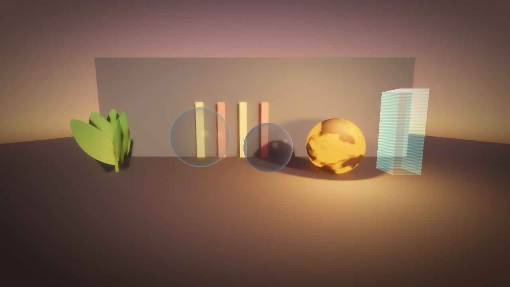
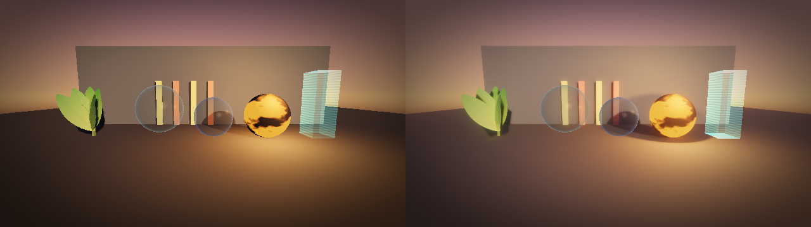

# Shader ve materyal yazmak (kod bilmeyen için)

Bu rehber, `examples/shader_showcase` örneğinin nasıl çalıştığını anlatır. Hepsini kendin
deneyebilirsin: örneği aç, `assets/` altındaki bir dosyayı kaydet, resim oyun durmadan değişir.



## İki dosya türü

| Dosya | Ne işe yarar | Örnek |
|---|---|---|
| `.ashader` | Bir yüzeyin **nasıl görüneceğinin tarifi**. Parlak mı, şeffaf mı, akıyor mu, sallanıyor mu | `shaders/lava.ashader` |
| `.material` | O tarife **verdiğin değerler**: renk, parlaklık, hız… | `materials/glass_blue.material` |

Bir shader'dan istediğin kadar materyal çıkar. Camın mavi hâli, camın kendisini kopyalamaz; sadece farkı yazar:

```json
{ "format": "astral.material", "version": 1,
  "parent": "materials/glass.material",
  "values": { "tint": [0.35, 0.50, 1.0], "opacity": 0.28 } }
```

## Örnekte neler var

| Materyal | Nasıl yapıldı |
|---|---|
| **Yaprak** (`leaf`) | Yaprağın kenarı kodla kesilir (`alpha_test`); uç kısmı rüzgârda daha çok sallanır (`vertex()`) |
| **Cam** (`glass`, `glass_blue`) | `blend_mix`: ortası şeffaf, kenarı parlak ve opak (fresnel). Arkadan öne sıralı çizilir |
| **Lav** (`lava`) | İki kat gürültü zamanla kayar; koyu kabuk çatlar, çatlaklar parlar. Etrafı da aydınlatır |
| **Hologram** (`hologram`) | `blend_add`: ışık ekler; kenar parlak, tarama çizgileri yukarı kayar, hafif titrer |
| **Gökyüzü** (`dusk_sky`) | `shader_type sky`: ufuktan tepeye renk geçişi, güneş diski |
| **Vinyet** (`vignette`) | `shader_type post`: bitmiş resmin köşelerini karartır |

## Kendi materyalini yapmak

1. `assets/shaders/` içine bir `.ashader` yaz (en kolayı örneklerden birini kopyalayıp değiştirmek).
2. `assets/materials/` içine `.material` yaz; `"shader"` alanına shader yolunu ver.
3. Oyun kodunda:
   - bir nesneye: `PrimitiveMesh{.shape = ..., .material_file = "materials/x.material"}`
   - kodla: `MaterialHandle m = ctx.load_material("materials/x.material");`
   - gökyüzü: `ctx.sky = ctx.load_material("materials/dusk_sky.material");`
   - ekran efekti: `ctx.post = {ctx.load_material("materials/vignette.material")};`

Bir şey yanlışsa oyun çökmez: hata `dosya:satır` ile loglanır, ekranda **son çalışan sürüm** kalır. Satır numarası
doğrudan `.ashader` dosyanın satırıdır.

## Canlı ayarlama

F1 → Windows → **Materials**: her materyal için kaydırıcılar ve renk seçiciler (shader'daki `range(...)` ve
`source_color` ipuçlarından otomatik çıkar). Değişiklik anında görünür ama dosyaya yazılmaz; beğendiğin
değeri `.material` dosyasına kendin yaz.

## Raster ve ışın izleme aynı görünür mü?

Evet: aynı materyal iki yolda da aynı yüzey değerlerini üretir. Soldaki resim yalnızca raster, sağdaki ışın
izlemeli (yumuşak gölge ve ortam ışığı farkı dışında aynı):



Küçük farklar: ışın izlemedeki yansıma ve GI hesabında `vertex()` çalışmaz (değer sıfır), dokular bulanık
örneklenir, alfa testiyle kesilen delikler yansımada görünmez, cam/hologram gibi şeffaf yüzeyler yansımada
yoktur.
