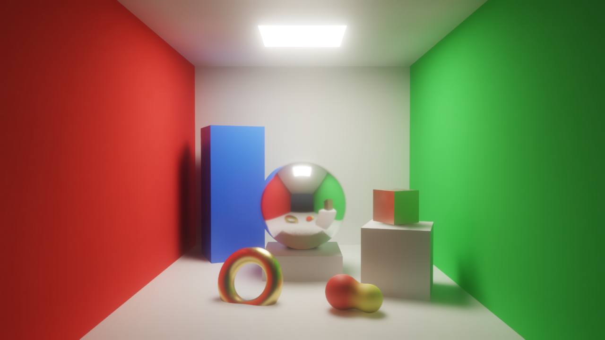
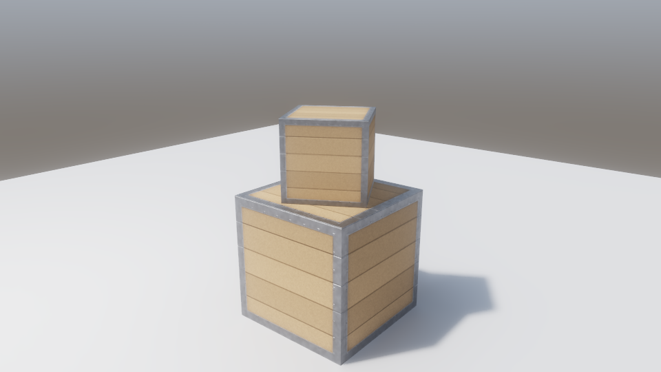

# Yol Haritası

Durum: ✅ bitti · 🚧 sürüyor · 🔜 sıradaki · ⬜ planlı

## Neredeyiz

| Faz | Kapsam | Durum |
|---|---|---|
| M0–M2 | Core, Platform, Vulkan RHI, kendi ECS'imiz, App | ✅ |
| M3, M3.5, M3.6 | Render graph; ray-traced aydınlatma (RT gölge, DDGI, RT yansıma, denoiser, TAA, bloom); render API v2 | ✅ |
| M4 | Fizik (Jolt): body'ler, raycast, temaslar, karakter | ✅ |
| M5a–c | ECS tamamlama, asset'ler (glTF, hot-reload), sahne ve prefab | ✅ |
| M6 | Paketleme: cook, BC7/BC5, `.apak`, `astral_add_game` | ✅ |
| M7 | İlk oyun: 3D Pong | ✅ |

## Plan (2026-11-21)

Hedef: shader/materyal, fizik, arazi, su ve hava sistemlerini **ortak altyapıların üstüne** kurmak. Su ve hava
tek başına özellik değil; dört temel mekanizmanın birleşimi: materyal/shader sistemi, şeffaf geçiş,
fizikte alanlar (fields) ve kuvvetler, GPU partikülleri. Bu yüzden önce temeller (M8–M11), sonra
özellikler (M12–M21).

| Faz | Kapsam | Bağımlı | Durum |
|---|---|---|---|
| M8 | Geliştirici altyapısı: debug UI, debug çizim, profiler, görüntü testleri; metin/HUD, ses | — | 🔜 |
| M9 | Shader ve materyal altyapısı: çalışma anında derleme, `.material`, özel yüzey fonksiyonu, alfa testi, şeffaf geçiş | M8 | ⬜ |
| M10 | Fizik altyapısı: katmanlar, mesh/heightfield, eklemler, sorgular; **alan sistemi** (rüzgâr, su hacmi) ve kuvvetler | M8 | ⬜ |
| M11 | Oyun mantığı ve scripting: Luau, oyun çatısı ([ADR-0017](decisions/0017-gameplay-scripting.md)) | M8 | ⬜ |
| M12 | Gelişmiş PBR: clearcoat, sheen, anizotropi, transmission, subsurface, decal, path tracer referansı | M9 | ⬜ |
| M13 | Atmosfer ve partiküller: fiziksel gökyüzü, IBL, hacimsel sis, GPU partikülleri | M9, M10 | ⬜ |
| M14 | Arazi I: Terrain3D benzeri heightfield (clipmap, bölgeler, 32 katman boyama, sculpt fırçaları, delikler, fizik, yerleştirme) ([ADR-0018](decisions/0018-terrain-and-sdf-world.md)) | M8, M9, M10 | ⬜ |
| M15 | Su I: okyanus ve göller (FFT dalga, kırılma, köpük, su altı, kıyılar) + dalgayı izleyen kaldırma kuvveti | M13, M14 | ⬜ |
| M16 | Hava II: hacimsel bulutlar, hava durumu (yağmur, ıslaklık), ileri aerodinamik | M12, M13 | ⬜ |
| M17 | Su II: etkileşimli su (GPU sığ su simülasyonu, iz, sıçrama, nehir akışı) | M15 | ⬜ |
| M18 | SDF dünya ve yıkım: seyrek SDF hacimleri (mağara, kemer), çalışma anında CSG (krater, kazma), yıkılabilir nesneler | M10, M14 | ⬜ |
| M19 | Animasyon: iskelet, GPU skinning, blend, root motion, skinned RT | M9 | ⬜ |
| M20 | Fizik II: ragdoll + aktif ragdoll, araçlar, kumaş/soft body, kopan parçalar ve önceden kırılmış mesh'ler | M10, M18, M19 | ⬜ |
| M21 | Dünya ölçeği: bölge streaming, HLOD, büyük ölçekli bitki örtüsü, GPU culling, meshlet LOD | M14, M18 | ⬜ |
| — | Kılıç arenası (yer tutucu): animasyon ve aktif ragdoll olgunlaşınca | M19, M20 | ⬜ |

### İlkeler

1. **Önce mekanizma, sonra özellik.** Su render'ı "şeffaf geçiş + materyal fonksiyonu + alan" üstüne
   yazılır, kendi özel yolunu açmaz. Sonraki her özellik bu mekanizmaları yeniden kullanır.
2. **Tek veri, iki tüketici.** Rüzgâr ve su gibi alanlar bir kez tanımlanır; fizik (CPU) ve partikül,
   bitki, kumaş, bulut (GPU) aynı tanımı örnekler. Görünen dalga ile fiziğin hissettiği dalga aynıdır.
3. **Veri ECS'te, davranış sistemlerde, içerik dosyalarda.** Yeni her component reflect edilir: sahne
   dosyası, editör paneli ve script bağlaması kendiliğinden gelir.
4. **Her şey çalışırken değişir.** Shader, materyal, script, sahne, prefab hot-reload. Tasarım döngüsü
   saniyeler.
5. **Ölçmeden optimize yok, görmeden kabul yok.** M8'den itibaren her faz profiler verisi ve görüntü
   testiyle (offscreen, CI'da lavapipe) biter; her fazın bir demo sahnesi olur.
6. **Doğruluk referansı.** M12'den itibaren gerçek zamanlı sonuçlar birikimli path tracer referansıyla
   karşılaştırılır.

### Faz ayrıntıları

**M8 — Geliştirici altyapısı ve oyun temelleri.** Sonraki her şeyi ayarlamak ve ölçmek için.
- Debug UI (Dear ImGui, kendi RHI'mizle çizilir): ayar panelleri; reflection'dan otomatik entity/component
  inspector'ı.
- Debug çizim: çizgi, kutu, küre, ok; fizik şekilleri, ışık ve alan hacimleri.
- Profiler: CPU kapsam zamanlayıcıları + GPU timestamp sorguları (pass başına), kare grafiği.
- Metin/HUD: MSDF font atlası, ekran uzayı 2D katmanı (metin, sprite, basit kutular).
- Ses: `Astral::Audio` (miniaudio). 2D/3D ses, mikser kanalları, streaming; `AudioSource`/`AudioListener`.
- Görüntü testleri: offscreen golden image karşılaştırması (tolerans ve fark görüntüsü).
- *Çıkış:* Pong'da ekranda skor ve sesler; profiler paneli; 3 sahnelik golden test.

**M9 — Shader ve materyal altyapısı.**
- Çalışma anında GLSL derleme (glslang) + shader hot-reload. Dağıtımda cook SPIR-V'yi önceden derler.
  Diskte pipeline önbelleği.
- `.material` asset'i: shading model + parametreler + texture'lar. Model, materyalleri bu dosyalara
  bağlar; materyal düzenlenince anında güncellenir.
- Özel yüzey fonksiyonu: `void surface(inout Surface s, in SurfaceInput i)`. Raster G-buffer'a ve RT vuruş
  uber-shader'ına derlenir (materyal id'ye göre dal). Aynı materyal iki yolda da aynı görünür.
- Vertex deformasyon kancası (rüzgârda sallanma, dalga). Deforme olan mesh'ler için BLAS güncelleme
  politikası.
- Alfa testi (yaprak, çit): raster, RT gölge ve RT vuruşlarında.
- Şeffaf/forward geçiş: sıralı şeffaflar, RT yansıma ve ekran uzayı kırılma. Su, cam ve partiküllerin
  ortak evi.
- *Çıkış:* cam, yaprak ve animasyonlu özel shader'lı materyaller dosyadan geliyor; shader düzenlenince
  oyun durmadan değişiyor.

**M10 — Fizik altyapısı ve alanlar.**
- Çarpışma katmanları ve filtreleri; mesh, convex hull, heightfield ve compound şekiller; eklemler
  (fixed, hinge, slider, distance, cone, 6DOF); shape cast ve overlap sorguları.
- Fizik materyalleri: yüzey tipi; ses ve VFX için temas bilgisi.
- Görsel interpolasyon (60 Hz üstü ekranlar); Jolt'u motorun JobSystem'ine bağlama.
- **Alan sistemi:** dünya uzayında örneklenen vektör/skalar alanlar. Rüzgâr (genel yön + yerel hacimler +
  türbülans gürültüsü + esintiler), su hacimleri (yüzey yüksekliği, akış, yoğunluk). CPU'da ve GPU'da
  aynı fonksiyon.
- Kuvvet üreticileri: kaldırma kuvveti + su içi sürükleme (batan hacim, şekilden), aerodinamik
  sürükleme/kaldırma (şekil katsayıları).
- *Çıkış:* yüzen kutular, rüzgârla sürüklenen nesneler, eklemli köprü, heightfield zemin.

**M11 — Oyun mantığı ve scripting.** Ayrıntı: [ADR-0017](decisions/0017-gameplay-scripting.md).
- `Astral::Script` (Luau): reflection'dan otomatik bağlama; sistem script'leri ve entity davranışları;
  script'te tanımlanan component'ler; olaylar; hot-reload; sandbox; tip tanımı üretimi (editör ve
  yapay zekâ için).
- Oyun çatısı: input eylemleri (tuş eşleme, gamepad), zamanlayıcılar/tween, tetik hacimleri, durum
  makinesi yardımcıları, kayıt sistemi.
- *Çıkış:* Pong'un kuralları Luau'ya taşınıyor ve aynı testleri geçiyor; script düzenlenince oyun
  durmadan değişiyor.

**M12 — Gelişmiş PBR.**
- Shading modelleri: clearcoat (araba boyası), sheen (kumaş), anizotropi (fırçalanmış metal),
  transmission (cam, ince ve kalın), subsurface (deri, mum, yaprak), ıslaklık parametresi.
- Enerji koruyan çoklu saçılma; detay haritaları, parallax occlusion, decal'lar.
- Path tracer referans modu (aynı sahne, birikimli).
- *Çıkış:* materyal test sahnesi, gerçek zamanlı ve referans görüntüler yan yana.

**M13 — Atmosfer ve partiküller.**
- Fiziksel gökyüzü (transmittance, çoklu saçılma ve gökyüzü LUT'ları), günün saati, aerial perspective.
  Gökyüzünden IBL; DDGI'a besleme.
- Hacimsel sis (froxel) ve ışık huzmeleri; rüzgârla taşınan yerel sis hacimleri.
- GPU partikülleri: emitter'lar, alan örnekleme (rüzgâr, su akışı), derinlik/SDF çarpışması, DDGI ile
  aydınlatma, şeffaf geçişte çizim.
- *Çıkış:* günün saati döngüsü; rüzgârda savrulan toz ve duman.

**M14 — Arazi I: heightfield (Terrain3D benzeri).** Karar: [ADR-0018](decisions/0018-terrain-and-sdf-world.md).
- Bölgelere ayrılmış veri: yükseklik (R32F), kontrol (temel/üst doku, karışım, UV döndürme/ölçek, delik),
  renk haritaları; `.aterrain` dosyaları, cook'lanır.
- GPU geometry clipmap ile raster çizim; RT için bölge başına kaba BLAS mesh'i (gölge, DDGI, yansıma).
- 32 katmanlı materyal: yüksekliğe dayalı karışım, eğime göre otomatik doku, tekrar kırma, makro varyasyon.
- Fizik: bölge başına heightfield şekli; delikler fizikte de delik.
- Motor içi düzenleme: yükselt, alçalt, düzleştir, yumuşat, rampa, boya, delik, renk fırçaları (GPU'da,
  geri alınabilir), debug arayüzünde.
- Yerleştirme: boya katmanlarına bağlı bitki/kaya örnekleyici, rüzgârla sallanma.
- *Çıkış:* motor içinde boyanıp şekillendirilmiş 2×2 km arazi; üstünde fizik ve karakter.

**M15 — Su I: okyanus ve göller.**
- Su hacmi (M10 alanı) + materyal: FFT okyanus (kademeli), göl/havuz yüzeyleri, kırılma, RT yansıma,
  derinliğe göre emilim ve renk, köpük, su altı (sis, huzme, kostik yaklaşımı). Kıyı köpüğü ve sığlık
  arazinin yüksekliğinden (M14).
- Fizik: kaldırma kuvveti dalga yüksekliğini CPU'da aynı fonksiyondan örnekler; görünen dalga ile
  hissedilen dalga aynı.
- *Çıkış:* kıyıya vuran dalgalı denizde sallanan tekne ve yüzen kasalar.

**M16 — Hava II: bulutlar ve hava durumu.**
- Hacimsel bulutlar (hava durumu haritası), bulut gölgeleri, rüzgârla sürüklenme.
- Hava durumu sistemi: bulutluluk, yağış, rüzgâr ve ıslaklık zamanla değişir; bunlar bulutları, sisi,
  yağmur partiküllerini, ıslak yüzeyleri ve su birikintilerini (arazi çukurlarında) sürer.
- İleri aerodinamik: balistik (mermi, ok), kanat kaldırma kuvveti (planör).
- *Çıkış:* açık havadan fırtınaya geçiş; ıslanan arazi.

**M17 — Su II: etkileşimli su.**
- GPU sığ su simülasyonu (yerel ızgara): nesne izleri ve dalgalar, sıçrama partikülleri, arazideki
  nehirler (akış haritaları), kıyı dalgaları; akış fizikte kuvvete dönüşür.
- Araştırma: yerel 3D akışkan efektleri (FLIP/SPH).
- *Çıkış:* suya düşen nesne dalga yapıyor; nehirde sürüklenen kütükler.

**M18 — SDF dünya ve yıkım.** Karar: [ADR-0018](decisions/0018-terrain-and-sdf-world.md).
- Seyrek tuğla SDF hacimleri: mağara, sarkan kaya, kemer; araziye delik açıp orada yüzeyi tanımlar.
- GPU'da mesh'e çevirme (surface nets / dual contouring) → normal mesh yolu (raster, RT, materyal);
  triplanar materyal, araziyle aynı katmanlar.
- Çalışma anında CSG: krater, kazma, tünel; yalnızca etkilenen parçalar yeniden mesh'lenir, BLAS ve çarpışma
  şekli güncellenir.
- Yıkılabilir nesneler: cook adımında mesh → SDF; çalışma anında çıkarma işlemleri; kopan parçaların
  bulunması (fiziğe M20'de geçer).
- *Çıkış:* arazide patlama kraterleri ve kazılan tünel; delinen ve parçalanan duvar.

**M19 — Animasyon.** İskelet, GPU skinning, glTF animasyonları, blend ağaçları, root motion, morph
target, skinned mesh için BLAS güncelleme. *Çıkış:* animasyonlu karakter RT gölge ve yansımada doğru.

**M20 — Fizik II.** Ragdoll ve aktif ragdoll (animasyon hedefli motorlar), araçlar (tekerlek,
süspansiyon), kumaş ve soft body (rüzgâr alanıyla), yıkım parçaları dinamik body olarak (M18) ve önceden
kırılmış (Voronoi) mesh'ler. *Çıkış:* rüzgârda dalgalanan bayrak, düşerek tepki veren karakter,
sürülebilir araç, parçaları yere dökülen duvar.

**M21 — Dünya ölçeği.** Arazi bölgeleri ve SDF hacimleri için hücre tabanlı streaming, HLOD, büyük ölçekli
bitki örtüsü, GPU culling ve meshlet LOD. *Çıkış:* birkaç km² açık dünya, akıcı streaming.

### Neden bu sıra

- **M8 önce:** atmosfer, su ve materyaller panelsiz ayarlanamaz, profiler'sız optimize edilemez,
  görüntü testleri olmadan bozulduğu fark edilmez.
- **M9 ve M10 iki omurga:** görsel tarafın her yeni özelliği materyal + şeffaf geçişe, simülasyon
  tarafının her yeni özelliği alanlar + kuvvetlere dayanıyor.
- **M11 temellerin hemen ardından:** su ve hava demoları script'le hızlı kurulur ve yapay zekâyla
  yazılır; component'ler reflect edildiği için yeni her özellik script'e kendiliğinden açılır.
- **Arazi sudan önce:** kıyılar, sığlıklar, nehirler ve su birikintileri arazinin yükseklik verisini okur.
- **Su ve hava iki dalgada:** önce render ve kuvvet (M15, M16), sonra etkileşim ve simülasyon (M17).
  İlk dalga ortak temelleri sınar; ikinci dalga onların üstüne kurulur.
- **SDF ve yıkım araziden sonra:** SDF hacimleri araziye delik açıp onun materyal katmanlarını kullanır;
  mesh çarpışma şekilleri (M10) ve mesh'e çevirme hazır olmalı.
- **Animasyon ve ragdoll sonra:** karakter içeriği gerektiriyor, kılıç arenası bunlara bağlı.

## Tamamlanan fazlar

## M0 — İskelet ve Core ✅

**Sonuç:** Modüler CMake sistemi (`astral_add_module`), `Astral::Core` modülü, 25 test,
ThreadSanitizer temiz, `find_package(Astral COMPONENTS Core)` ile kullanılabilir,
GCC/Clang/MSVC + TSan CI. Bağımsız inceleme bir kilitlenme hatası buldu; düzeltildi.
Ayrıntı: [modules/core.md](modules/core.md).

**Devreden borç:** [core.md → Bilinen sınırlar](modules/core.md#bilinen-sınırlar).

## M1 — Platform ve GPU ✅

**Sonuç:** Vulkan 1.3 RHI (handle, bindless, BDA, timeline, gecikmeli silme, swapchain), SDL3
pencere/input, kendi matematik kütüphanemiz, `hello_triangle`. GPU testleri lavapipe ile
headless, pencere+present testi Xvfb ile koşuyor; validation hatası yok. Public header kuralı
artık otomatik test. Ayrıntı: [gpu.md](modules/gpu.md), [platform.md](modules/platform.md).

**Bitiş kriterleri (karşılandı):** `examples/hello_triangle` pencerede üçgen çizer; GPU modülü
pencere olmadan (headless/offscreen) da çalışır ve testleri CI'da yazılımsal Vulkan
(lavapipe) ile koşar; public header'larda Vulkan/SDL tipi yok.

## M2 — Dünya ve App ✅

**Sonuç:** Kendi archetype ECS'imiz (cache dostu SoA, paralel sorgu, ertelenmiş komutlar, hiyerarşi),
instanced forward renderer, `App` + `Game` + `System`; `spinning_cubes` 576 küpü component/system
olarak yazılmış oyun koduyla çiziyor. M1 incelemesinin 1 kritik + 9 önemli, M2 incelemesinin 2 kritik + 3 önemli bulgusu testle düzeltildi;
tüm suite ASan/LSan, TSan ve `-Werror` (GCC/Clang) altında temiz.
Rehber: [writing-a-game.md](guides/writing-a-game.md).

**Bitiş kriterleri (karşılandı):** `examples/spinning_cubes`: oyun kodu yalnızca `Game` + component + system
yazar; ECS sorguları JobSystem ile paralel; system'ler headless test edilir.

## M3 — Render ✅

**Sonuç:** Render graph (otomatik bariyer, havuz, ayıklama) ve üzerinde hibrit deferred renderer:
gölge haritası, mesh G-buffer, SDF raymarch (CSG + yumuşak birleşim), PBR aydınlatma, SDF yumuşak
gölgeleri, nokta ışıklar, ACES. `examples/sdf_scene`. İncelemenin 6 önemli bulgusu testle düzeltildi. Brick bake, TAA, IBL,
cascaded gölgeler sonraki alt fazlara kaldı ([render.md](modules/render.md)).

**Bitiş kriterleri (karşılandı):** render graph pass ekleme/çıkarma mevcut pass'lere dokunmadan yapılır;
eski v2'deki deferred + SDF teknikleri bu mimariye temiz yeniden yazılmış olur.

## M4 — Fizik ✅

**Sonuç:** Jolt üzerine `Astral::Physics` (body'ler, şekiller, sensörler, CCD, raycast, temas olayları,
karakter kontrolcüsü); App'te `RigidBody`/`CharacterController`, sabit 60 Hz adım. `examples/physics_demo`.
İncelemenin 7 önemli bulgusu testle düzeltildi; fizik TSan altında temiz.
Ayrıntı: [physics.md](modules/physics.md).

**Bitiş kriterleri (karşılandı):** `physics_demo` (düşen kutular, raycast); fizik renderer olmadan test edilir.

## M3.5 — Fotogerçekçi render ✅

**Sonuç:** RHI'de ray tracing (BLAS/TLAS, adresle ray query); renderer'da ray-traced yol: RT gölgeli doğrudan
ışık + alan ışıkları, DDGI + yakın alan RTGI, GGX yansımalar, SVGF tarzı denoiser, TAA, bloom
([ADR-0011](decisions/0011-hybrid-ray-traced-lighting.md)). `examples/rt_showcase`. Raster yolu yedek olarak
korunuyor. Shader include bağımlılık hatası bulundu ve düzeltildi.
**Bağımsız inceleme bu fazda henüz yapılmadı** — sonraki adımlardan biri.

**Bitiş kriterleri (karşılandı):** RT destekli cihazda (lavapipe dahil) gölge, alan ışığı, ayna yansıması,
renk taşması ve SDF katılımı testlerle doğrulanır; validation temiz; RT yoksa raster yoluna düşer.

## M3.6 — Render API v2 ✅

**Sonuç:** Kaynak/kare ayrımı netleşti: mesh ve materyal paylaşılan handle'lar, kare verisi saf `RenderScene`.
Materyal tablosu raster ve RT yollarında ortak. G-buffer hız hedefi; App transform geçmişini kendisi tutar.
`set_settings` ile çalışma anında teknik değişimi. 27 render testi (materyal, ayar, hareket dahil).

## M5a — ECS tamamlama ✅

**Sonuç:** ECS yeniden yazılmadı, üstü tamamlandı: değişiklik takibi (satır başına tick, sistem başına referans),
filtreli sorgular, olaylar, reflection ve JSON ile dünya kaydet/yükle (entity referansları yeniden eşlenir).
Core'a bağımlılıksız `Json` ve `ASTRAL_REFLECT` ([ADR-0013](decisions/0013-ecs-change-detection-reflection.md)). ThreadSanitizer temiz. Ayrıntı: [world.md](modules/world.md).

**Bitiş kriterleri (karşılandı):** bir dünya JSON'a kaydedilip başka bir dünyaya yüklenir ve yeniden kaydedildiğinde
bayt bayt aynı belgeyi verir; App sistemleri `changed<T>()` ile yalnız kendi görmedikleri değişiklikleri görür.

## M5b — Asset'ler ✅

**Sonuç:** `Astral::Assets` ([assets.md](modules/assets.md), [ADR-0014](decisions/0014-assets.md)): kalıcı
AssetId, asenkron glTF/GLB yükleme, texture'lı PBR materyaller (raster + RT), handle koruyan hot-reload,
sahnede `ModelRef`. `examples/model_viewer`.

## M5c — Sahne ve prefab ✅

**Sonuç:** `astral.scene` v1 biçimi (sahne ve prefab aynı biçimde). Kayıtlar kalıcı `id` taşıyor, tekrar
kaydetmede diff yalnızca değişen satırlarda çıkıyor. Prefab örnekleri yalnızca farklarını saklıyor
(`components`/`parts` yamaları, `removed`, `deleted`); farklar kayıt anında hesaplanıyor, yani koddan
yapılan değişiklik de override oluyor. İç içe prefab ve varyant, örnek içine referans (`"2/5"`),
hot-reload'da override'ları koruyan yeniden açılış var. Ek olarak isimle yazılan enum'lar,
`PrimitiveMesh`, App'te `load_scene`/`save_scene`/`spawn_prefab` ve offscreen render. RGB oda artık bir
`.scene` dosyası (`examples/scene_viewer`). Testler: debug 10/10, TSan temiz.
Ayrıntı: [ADR-0015](decisions/0015-scenes-and-prefabs.md), [modules/world.md](modules/world.md#sahneler-ve-prefablar).

**Devreden borç:** ikili sahne biçimi (M6 cook), açık dünya hücreleri/streaming (sonraki faz), sahne
başına render ayarları dosyada değil, bağımsız inceleme yapılmadı.

## M6 — Paketleme ✅

**Sonuç:** `astral-cook` aracı (`cook_directory`): kaynak klasörü aynı yollarla cook eder. glTF → `AMDL`
(texture'lar kullanıma göre BC7 sRGB / BC7 / BC5, hazır mip zinciri; `.bin` ve görüntüler modele katılır),
sahne/prefab → ikili JSON, geri kalanı kopya. İçerik hash'li artımlı önbellek var. `.apak`: dosya başına zstd,
okumada boyut ve hash doğrulaması. `AssetManager` pack'ten ya da gevşek (kaynak veya cook edilmiş)
klasörden içeriğe bakarak okur; BC'siz GPU'da RGBA8'e açar. GPU'ya BC5/BC7, renderer'a hazır mip zinciri
eklendi; normal map Z'si shader'da. `AppDesc::pack` (exe'nin yanında varsa kullanılır), `astral_add_game`
+ `<oyun>_package` (çalıştırılabilir klasör), kurulu pakette `Astral::astral_cook`. Paketli RGB oda gevşek
modla aynı görüntüyü veriyor (ortalama fark 0.006/255). Testler: debug 12/12, release `-Werror`, TSan temiz,
`tests/consumer` kurulu paketle oyunu cook edip çalıştırıyor.
Ayrıntı: [ADR-0016](decisions/0016-packaging.md), [modules/assets.md](modules/assets.md#cook-ve-paket-m6).

**Devreden borç:** memory-map ve kısmi okuma yok, prefab şablon cook'u yok (sahne yine JSON
değerlendirmesi), ASTC/mobil yok, bağımsız inceleme yapılmadı.

## M7 — İlk oyun: 3D Pong ✅

**Sonuç:** `examples/pong`: tünelde 3D Pong ("Curveball"). Oyuncu WASD/oklar/fare ile oynuyor, karşıda
yapay zekâ var, topun rakete çarptığı nokta yönünü büküyor, 5 sayıda maç bitiyor. Oyun kodu iki dosya
(`pong.hpp/.cpp`: 5 component, 5 sistem). Görünen her şey `court.scene` ve 5 prefab'da; bunlara oyunun
kendi component'leri (`pong::Paddle`, `pong::Court`...) dahil. Rakip raket bir prefab **varyantı**,
derinlik halkası override'lı bir prefab örneği. Testler headless ve deterministik: dört dakikalık AI-AI
maçı 2 saniyede, kurallar ayrı ayrı. `pong_package` ile paketleniyor. Görüntü:
[images/m7-pong.png](images/m7-pong.png).

**Pong'un motorda bulduğu eksikler** (sonraki fazların girdisi):
- Ses yok: çarpma ve sayı sesi çalınamıyor → M8.
- Metin/HUD yok: skor pencere başlığına ve sahnedeki ışıklara yazıldı → M8.
- `astral.hpp` `Window` ve sahne API'sini içermiyordu → bu fazda düzeltildi.
- Tekil component'e (kural nesnesi) erişim için yardımcı yok (`each` + ilk eleman) → küçük iş.
- Yakalama her kareyi çiziyor; mantığı hızlıca ileri sarıp yalnız son kareleri çizmek mümkün değil.
- Bir component'in materyalini değiştirmek yeni bir materyal oluşturuyor; önbellek hiç boşalmıyor
  (`PrimitiveMesh`).
