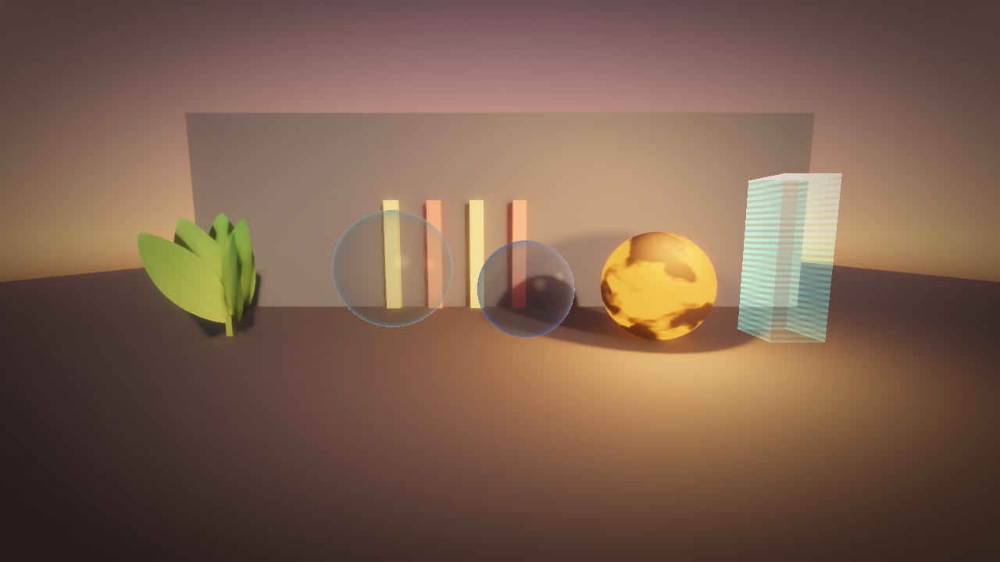

# Yol Haritası

Durum: ✅ bitti · 🚧 sürüyor · 🔜 sıradaki · ⬜ planlı

## Neredeyiz

| Faz | Kapsam | Durum |
|---|---|---|
| M0–M2 | Core, Platform, Vulkan RHI, kendi ECS'imiz, App | ✅ |
| M3, M3.5, M3.6 | Render graph; ray-traced aydınlatma (RT gölge, DDGI, RT yansıma, denoiser, TAA, bloom); render API v2 | ✅ |
| M4 | Fizik (Jolt): body'ler, raycast, temaslar, karakter | ✅ |
| M5a–c | ECS tamamlama, asset'ler (glTF, hot-reload), sahne ve prefab | ✅ |
| M6 | Paketleme: cook, BC7/BC5, `.apak`, `astral_add_game` | ✅ |
| M7 | İlk oyun: 3D Pong | ✅ |
| M8 | Geliştirici araçları, metin/HUD, ses, görüntü testleri | ✅ |
| M9 | Dünya ve harita sistemi: `.world` + `.ent`, hücre streaming, katmanlar, kayan orijin | ✅ |
| M10 | Shader dili (`.ashader`) ve materyaller (`.material`): yaprak, cam, lav, hologram, sky, post | ✅ |

## Plan v4 (2026-11-21)

Hedef: **Unreal 5 seviyesinde bir dünya sistemi** (açık dünyada da hızlı), **yapay zekâyla rahat yazılan,
spagettiye dönmeyen** oyun kodu, **gdshader benzeri özel shader/materyal** dili ve **hacim tabanlı VFX**
(CS2 dumanı gibi); bunların üstüne fizik, arazi, su ve hava. Su ve hava tek başına özellik değil; ortak
mekanizmaların birleşimi: materyal/shader dili, şeffaf geçiş, fizikte alanlar ve kuvvetler, hacimsel
render ve GPU partikülleri. Bu yüzden önce temeller (M8–M12), sonra özellikler (M13–M22).

v3'ten fark: kullanıcı öncelikleriyle **dünya/harita sistemi** (yeni M9) ve **modüler oyun kodu**
(ADR-0023, M11) öne alındı, shader işi bir dile (ADR-0022) dönüştü, M14 hacimsel VFX'i (ADR-0024) içeriyor.
Sonraki fazların numarası birer kaydı.

| Faz | Kapsam | Bağımlı | Durum |
|---|---|---|---|
| M8 | Geliştirici altyapısı: debug UI, debug çizim, profiler, metin/HUD, ses; görüntü testleri | — | ✅ |
| M9 | **Dünya ve harita sistemi:** `.world`, nesne başına dosya, hücreler + asenkron streaming, veri katmanları, bölüm örnekleri, kayan orijin ([ADR-0021](decisions/0021-world-and-level-system.md)) | M8 | ✅ |
| M10 | **Shader dili ve materyaller:** `.ashader` (gdshader benzeri), `.material` + örnekler, çalışma anında derleme + hot-reload, raster/RT/gölge/forward varyantları, alfa testi, şeffaf geçiş ([ADR-0022](decisions/0022-shader-and-material-language.md)) | M8 | ✅ |
| M11 | **Oyun kodu ve scripting:** özellik paketleri + SOLID kuralları + sınır denetimi ([ADR-0023](decisions/0023-modular-game-code.md)), Luau ([ADR-0017](decisions/0017-gameplay-scripting.md), [ADR-0026](decisions/0026-script-host-and-features.md)), input eylemleri, `AGENTS.md`, üretilen API belgesi | M9 | ✅ |
| M12 | Fizik altyapısı: katmanlar, mesh/heightfield, eklemler, sorgular; **alan sistemi** (rüzgâr, su hacmi) ve kuvvetler ([ADR-0029](decisions/0029-physics-fields-and-joints.md)) | M8 | ✅ |
| M13 | Gelişmiş PBR: clearcoat, sheen, anizotropi, transmission, subsurface, decal, path tracer referansı | M10 | 🔜 |
| M13.5 | **Kod sağlığı ve modülerlik:** güvenlik ağı (Windows Debug CI, `.gitattributes`, doctest, donanımdan bağımsız görüntü testleri, boyut bütçesi), god class'ların bölünmesi (renderer, app/Context, debug UI, cook, glTF, asset yöneticisi, fizik, script bağlamaları, sahne, GPU cihazı), header ve derleme süresi hijyeni; davranış değişmez ([ADR-0030](decisions/0030-refactor-rules-and-size-budget.md), [ADR-0031](decisions/0031-hardware-independent-golden-tests.md)) | M13 | ✅ |
| M13.6 | **Ölçeklenebilir çalışma zamanı:** erişim bildiren sistemler + deterministik paralel zamanlayıcı, paralel transform yayılımı, ana thread'den çıkan shader derleme ve hücre G/Ç, toplu script sorguları, ölçek benchmark'ları | M13.5 | ⬜ |
| M14 | **Atmosfer ve VFX:** fiziksel gökyüzü, froxel sis, **hacimsel efektler (CS2 dumanı)**, GPU partikülleri, decal/iz, `.vfx` ([ADR-0024](decisions/0024-volumetric-vfx.md)) | M10, M12 | ⬜ |
| M15 | Arazi I: Terrain3D benzeri heightfield (clipmap, bölgeler, 32 katman, sculpt, delik, fizik, yerleştirme), dünya hücreleriyle stream ([ADR-0018](decisions/0018-terrain-and-sdf-world.md)) | M9, M10, M12 | ⬜ |
| M16 | Su I: okyanus ve göller (FFT dalga, kırılma, köpük, su altı, kıyılar) + dalgayı izleyen kaldırma kuvveti | M14, M15 | ⬜ |
| M17 | Hava: hacimsel bulutlar, hava durumu (yağmur, ıslaklık), ileri aerodinamik | M13, M14 | ⬜ |
| M18 | Su II: etkileşimli su (GPU sığ su simülasyonu, iz, sıçrama, nehir akışı) | M16 | ⬜ |
| M19 | SDF dünya ve yıkım: seyrek SDF hacimleri, çalışma anında CSG, yıkılabilir nesneler ([ADR-0018](decisions/0018-terrain-and-sdf-world.md)) | M12, M15 | ⬜ |
| M20 | Animasyon: iskelet, GPU skinning, blend, root motion, IK (ayak yerleştirme, bakış, uzanma), skinned RT | M10 | ⬜ |
| M21 | **Karakter fiziği:** ragdoll, kaslar, aktif ragdoll, Euphoria tarzı davranışlar (denge, darbe, düşüş, kalkma) ([ADR-0025](decisions/0025-physics-based-character-animation.md)) | M12, M20 | ⬜ |
| M22 | Dünya ölçeği II: HLOD, büyük ölçekli bitki örtüsü, GPU-driven culling, meshlet LOD | M9, M15, M19 | ⬜ |
| M23 | Fizik III: araçlar, kumaş/soft body (rüzgâr alanıyla), kopan parçalar, önceden kırılmış mesh'ler | M12, M19, M21 | ⬜ |
| — | Kılıç arenası (yer tutucu): animasyon ve aktif ragdoll olgunlaşınca | M20, M21 | ⬜ |

### İlkeler

1. **Önce mekanizma, sonra özellik.** Su render'ı "şeffaf geçiş + `.ashader` + alan" üstüne yazılır,
   kendi özel yolunu açmaz. Duman "hacimsel efekt + `volume` shader" üstüne.
2. **Tek veri, iki tüketici.** Rüzgâr ve su alanları bir kez tanımlanır; fizik (CPU) ve partikül, bitki,
   kumaş, bulut (GPU) aynı tanımı örnekler. Dumanın oyun ızgarası görüşü de görüntüyü de sürer.
3. **Veri ECS'te, davranış sistemlerde, içerik dosyalarda.** Yeni her component reflect edilir: sahne
   dosyası, editör paneli ve script bağlaması kendiliğinden gelir.
4. **SOLID her zaman** ([architecture.md](architecture.md), [ADR-0023](decisions/0023-modular-game-code.md)):
   yeni davranış yeni sistem/olayla eklenir, mevcut kod değiştirilmez; global durum yok; servisler arayüzle.
5. **Yapay zekâ dostu.** Küçük kalıplı dosyalar, reflection'dan üretilen API belgesi ve tip tanımları,
   headless testler, otomatik sınır denetimi. Ajan tahmin etmez, okur ve test eder.
6. **Her şey çalışırken değişir.** Shader, materyal, script, sahne, prefab, dünya hücresi hot-reload.
7. **Ölçmeden optimize yok, görmeden kabul yok.** Her faz profiler verisi ve görüntü testiyle (offscreen,
   CI'da lavapipe) biter; her fazın bir demo sahnesi olur.
8. **Doğruluk referansı.** M13'ten itibaren gerçek zamanlı sonuçlar birikimli path tracer referansıyla
   karşılaştırılır.

### Faz ayrıntıları

**M8 — Geliştirici altyapısı ve oyun temelleri.** ✅ Ayrıntı aşağıda (Tamamlanan fazlar → M8).

**M9 — Dünya ve harita sistemi.** ✅ Ayrıntı aşağıda (Tamamlanan fazlar → M9). Karar: [ADR-0021](decisions/0021-world-and-level-system.md).
- `.world` biçimi (dünya ayarları, ızgaralar, veri katmanları); `<harita>.entities/` klasöründe nesne başına
  dosya; tek `.scene` küçük haritalar için geçerli kalır.
- Cook: entity'leri sınır kutusuna göre hücrelere dağıtır, hücre başına ikili blok.
- Çalışma anı: `StreamingSource`, asenkron hücre yükleme (JobSystem), kare bütçeli birleştirme, histerezisli
  boşaltma, hücre farkı olarak saklanan oyun durumu, hücreler arası kalıcı referanslar.
- Veri katmanları (açma/kapama), bölüm örnekleri (`.scene` → dünyaya yerleştirme), `ctx.open_world`.
- Kayan orijin: dosyada `double`, çalışırken orijine göre `float`; fizik ve render geçmişi birlikte kayar.
- Araçlar: debug UI'da hücre görünümü, yükleme yarıçapları (debug çizim), profiler'da streaming istatistiği.
- *Çıkış:* 4×4 km test dünyası (binlerce prosedürel nesne), kamera uçarken takılmasız streaming; aynı
  dünyada gece katmanı aç/kapa; iki nesne dosyası ayrı ayrı düzenleniyor.

**M10 — Shader dili ve materyaller.** ✅ Ayrıntı aşağıda (Tamamlanan fazlar → M10). Karar: [ADR-0022](decisions/0022-shader-and-material-language.md).
- glslang ile çalışma anında derleme; `.ashader` başlık ayrıştırıcısı; built-in'ler; hata satır eşlemesi.
- `shader_type surface` → G-buffer, gölge, RT vuruş (uber-shader'a eklenen dal), forward/şeffaf varyantları;
  `vertex()` deformasyonu ve deforme mesh'ler için BLAS güncelleme politikası; alfa testi her yolda.
- `.material` (+ ebeveyn zinciri), uniform ipuçlarından otomatik materyal paneli, `MaterialOverride`;
  glTF materyalleri `standard.ashader` örneği olarak.
- Şeffaf/forward geçiş: sıralı şeffaflar, RT yansıma, ekran uzayı kırılma. `post` ve `sky` türleri.
- Cook'ta önceden derleme, diskte pipeline önbelleği.
- *Çıkış:* rüzgârda sallanan yaprak, cam, akan lav ve hologram materyalleri dosyadan; shader düzenlenince
  oyun durmadan değişiyor; raster ve RT görüntüleri aynı materyali gösteriyor.

**M11 — Oyun kodu ve scripting ✅** (sonuç: aşağıda "Tamamlanan fazlar"). Kararlar: [ADR-0023](decisions/0023-modular-game-code.md),
[ADR-0017](decisions/0017-gameplay-scripting.md).
- Özellik paketleri (`feature.json`, `install`), bağımlılık sırası, sınır denetimi (build/lint).
- `Astral::Script` (Luau): reflection'dan bağlama, sistem script'leri ve entity davranışları, script'te
  component, olaylar, hot-reload, sandbox; `astral.d.luau` ve `API.md` üretimi.
- Oyun çatısı: input eylemleri (tuş eşleme, gamepad), zamanlayıcılar/tween, tetik hacimleri, durum
  makinesi yardımcıları, kayıt sistemi.
- `AGENTS.md`: yapay zekâ ajanları için özellik iskeleti, kurallar, komutlar.
- *Çıkış:* Pong özellik paketlerine bölünüyor, kuralları Luau'da ve aynı testleri geçiyor.

**M12 — Fizik altyapısı ve alanlar.**
- Çarpışma katmanları; mesh, convex hull, heightfield ve compound şekiller; eklemler; shape cast ve overlap.
- Fizik materyalleri (yüzey tipi → ses ve VFX), görsel interpolasyon, Jolt'u JobSystem'e bağlama.
- **Alan sistemi:** rüzgâr (genel + yerel hacimler + türbülans + esinti), su hacimleri (yükseklik, akış,
  yoğunluk); CPU'da ve GPU'da aynı fonksiyon. Kuvvetler: kaldırma, su içi ve hava sürüklemesi.
- *Çıkış:* yüzen kutular, rüzgârla sürüklenen nesneler, eklemli köprü, heightfield zemin.

**M13 — Gelişmiş PBR.** Clearcoat, sheen, anizotropi, transmission, subsurface, ıslaklık; enerji koruyan
çoklu saçılma; detay haritaları, parallax, decal'lar; path tracer referans modu. Hepsi `.ashader`'da
`shading_model` seçenekleri olarak. *Çıkış:* materyal test sahnesi, gerçek zamanlı ve referans yan yana.

**M13.5 — Kod sağlığı ve modülerlik (refaktör).** Kararlar faz başında: ADR-0030 (refaktör kuralları, boyut
bütçesi, "god class" tanımı), ADR-0031 (donanımdan bağımsız görüntü testleri).

*Neden:* 2026-11-22 mimari incelemesi. Katmanlar, kurallar ve testler sağlam; ama birkaç dosya her fazda
büyüyen "toplama noktası" oldu (`renderer.cpp` 1835 satır, `Renderer::Impl` 69 üye, `render_ray_traced` 396
satırlık tek fonksiyon; `app.cpp` 1459 satır, `App::Impl` 106 satır, `Context` ~25 metot ve her fazda artıyor).
Bunlar paralel çalışmada (görev başına worktree → master) merge çakışması ve yapay zekâ ajanları için bağlam
yükü demek. İlk Windows/MSVC derlemesi de CI'ın yakalamadığı dört hata buldu (`0be42b0`).

*Değişmez kurallar (bu faz boyunca):*
- **Davranış değişmez.** Her adım saf yapısal; public API kaynak uyumlu kalır (değişen her şey bir faz
  `[[deprecated]]` sarmalayıcıyla yaşar). Lavapipe görüntü testleri **bit bit aynı** kalmalı.
- **Önce karakterizasyon testi, sonra taşıma.** Bölünecek kodun mevcut davranışı (kare aşama sırası, render
  istatistikleri, cook çıktısının hash'i) önce testle sabitlenir.
- **Tek sorumluluk ölçütü:** bir sınıf/dosya birden fazla nedenle değişiyorsa bölünür. Boyut tek başına ölçüt
  değil: tutarlı bir ayrıştırıcı (`core/json.cpp` `Parser` 216 satır, `shader/ashader.cpp` `Parser` 167 satır)
  bölünmez.
- **Hedef bütçe:** `src/` dosyası ≤ 600 satır, fonksiyon ≤ 80 satır, `Impl` ≤ 25 üye. Aşan yerler bilinçli
  istisna listesinde (gerekçeli) durur; liste yalnızca küçülür.
- **Her adım ayrı worktree, ayrı merge.** R1–R3 işleri dosya sahipliği ayrıştığında paralel yürüyebilir.
  R1 hazırlığı R0 doğrulanırken başlayabilir. R1 adayları tamamlanmış R0 üzerine alınıp doğrulanır.

*R0 — Güvenlik ağı (önce bu).*
- **Windows Debug CI job'u:** MSVC Debug (`_ITERATOR_DEBUG_LEVEL=2`), `ASTRAL_WARNINGS_AS_ERRORS=ON`, unit
  testler. STL debug kontrolleri `vector::assign` türü tanımsız davranışı yakalar (M13'e kadar Linux ve Windows
  Release'te gizli kalmıştı).
- **`.gitattributes`:** `* text=auto eol=lf`; `*.png *.glb *.ttf *.apak binary`. Repoyu bir kez normalize et.
  Metin ayrıştıran her kod (GLSL gömme, `.ashader`, `.material`, JSON, `.actions`) yine de CRLF'e dayanıklı
  kalır ve bunun testi olur (kullanıcı dosyaları Windows'ta CRLF gelebilir).
- **doctest 2.4.11 → 2.5.x:** CMake 4 (`cmake_minimum_required < 3.5`) ve MSVC 14.51 STL uyumsuzluğu biter;
  yerel `CMAKE_POLICY_VERSION_MINIMUM` ve `DOCTEST_CONFIG_USE_STD_HEADERS` geçici çözümleri kalkar. README'deki
  araç sürümleri (CMake 4, VS 2026) güncellenir.
- **Görüntü testleri donanımdan bağımsız ([ADR-0031](decisions/0031-hardware-independent-golden-tests.md)):** referanslar lavapipe'ta üretiliyor; gerçek GPU'larda
  (ör. RTX 3060) beş test sürekli kırmızı (`scene_viewer`, `open_world` ×3, `shader_showcase`). İkiye ayır:
  `golden` (`ctest -L '^golden$'`) = lavapipe, CI'da zorunlu, piksel toleranslı; `golden-hw` (`ctest -L '^golden-hw$'`) = donanım GPU'su,
  algısal metrik (parlaklık SSIM + güçlü piksel farkı sınırı) ve RT gürültüsü için sabit tohum + yeterli birikim. Yerelde `ctest -L '^golden$'`
  lavapipe yoksa atlanır ve nedenini söyler; referans güncelleme yalnız lavapipe üzerinde `ASTRAL_UPDATE_GOLDEN=1 ctest -L '^golden$'`.
  Yanlış alarm veren test güveni bitirir: amaç "kırmızı = gerçek hata".
- **Boyut bütçesi denetimi:** `tools/check_sizes.py` + CTest `code_size_check` (dosya/fonksiyon/`Impl` üye
  sayısı, istisna listesi `tools/size_budget.json`). Önce uyarı, R1–R3 bitince hata.
- **Include hijyeni:** CI'da clang-tidy `misc-include-cleaner` (yalnız bizim kaynaklar). `std::clamp` için
  eksik `<algorithm>` türü hatalar derleyiciye bağlı kalmaz.
- **Katman diyagramı gerçeği gösterir ve denetlenir:** [architecture.md](architecture.md) diyagramında `shader`
  modülü yok (`render` ona bağlı); Katman 2 içi bağımlılıkların oku yok (`assets → render, world`,
  `script → world`, `render → shader`), bu yüzden "aynı katmanda ok yönünde" kuralı denetlenemiyor. Diyagram
  gerçek DAG olarak yeniden çizilir. `tools/check_layers.py` ve CTest `layer_check`, yapılandırılmış
  CMake modüllerinin `DEPS` ve `PRIVATE_DEPS` içindeki motor bağımlılıklarını izinli kenarlarla
  karşılaştırır. Yeni kenarlar belge ve gerekirse ADR ile eklenir. Döngüler hata sayılır.
- **`assets` → `render` başlık bağını daraltmak:** `assets/model.hpp` zaten `render/mesh.hpp` kullanıyor.
  `ModelImage`, `ImageData`yı değer olarak tuttuğundan tam tanım gerekiyor. `ImageData` hafif bir
  public başlığa taşınır ve `renderer.hpp` mevcut kullanıcıları için tipi sunmaya devam eder.
  Geçişli include'a dayanan kaynaklar aynı adımda düzeltilir. GPU yükleme `asset_manager.cpp`'de kalır.
- **Repo hijyeni:** yerel ajan ayarları, çalışma klasörleri ve üretilen Graphify çıktıları ignore edilir.
  Paylaşılan kurallar açıkça benimsenip izlenen proje dokümanlarına eklenir.
- *Çıkış:* `layer_check` ve başlık denetimi geçer. Windows MSVC Debug `/WX` derlemesi, tüm görüntü
  dışı testler ve 12 donanım golden geçer. RTX üzerinde 12 yazılım golden beklenen şekilde atlanır.
  Linux lavapipe, GCC/Clang ve Windows Release kanıtı CI koşusundan kaydedilir.

*R1 — Renderer'ı bölmek* (`modules/render/src/renderer.cpp`). Hedef düzen:

| Yeni dosya | Ne taşınır | Bugün |
|---|---|---|
| `gpu_layouts.hpp` | `GpuMesh`, `GpuInstance`, `GpuMaterial`, `GpuFrame`, ışıklar, 15+ push constant yapısı (`scene.glsl` aynası) | renderer.cpp 35–230 |
| `stores/mesh_store.cpp` | `create/update/destroy_mesh`, `upload_mesh`, BLAS | 1007–1070 |
| `stores/texture_store.cpp` | `build_mips`, `upload_texture`, `create/update/destroy_texture` | 71–100, 496–523, 981–1006 |
| `stores/material_store.cpp` | `gpu_material`, parametre kelimeleri, materyal tablosu | 485–495, 1071–1098, `prepare_instances` içi |
| `stores/shader_store.cpp` | `create_shader` (surface + screen), `rebuild_rt_surfaces`, RT pipeline'ları | 524–553, 862–980 |
| `frame/frame_slot.hpp`, `frame/instances.cpp` | `FrameSlot`, `GrowBuffer`, `prepare_instances`, TLAS | 239–300, 651–752 |
| `passes/*.cpp` | her pass ayrı: gbuffer, shadow, sdf, rt_lighting, ddgi (ensure + trace + update), denoise (temporal + à-trous), composite, taa, bloom, sky, transparent, post, tonemap, ui, debug_lines | 554–829, 1136–1800 |
| `paths/raster_path.cpp`, `paths/ray_traced_path.cpp` | yalnız pass'leri sırayla ekler | `render` 206 satır, `render_ray_traced` 396 satır |

- Her pass küçük bir yapı: `struct BloomPass { void add(RenderGraph&, const FrameInputs&, …); }`; kendi
  pipeline'ını ve geçmiş dokusunu sahiplenir. Pass'ler birbirini çağırmaz, render graph kaynaklarıyla konuşur
  (açık/kapalı: yeni teknik = yeni pass dosyası, mevcut dosyalar değişmez).
- `Renderer::Impl` yalnız store'ları, pass'leri ve kare yuvalarını tutar (≤ 25 üye).
- Karakterizasyon: lavapipe golden'ları + `RenderStats` sayaçları + pass sırası (render graph'ın ürettiği pass
  listesi) testle sabitlenir; her taşıma adımından sonra bit bit aynı.
- *Çıkış:* `renderer.cpp` ≤ 400 satır, 80 satırı aşan fonksiyon yok, golden'lar değişmemiş.

*R2 — App ve Context'i bölmek* (`modules/app/src/app.cpp`, `include/astral/app/app.hpp`).
- `App::Impl` içindeki işler ayrı iç servislere (`modules/app/src/services/`), her biri kendi `.hpp/.cpp`,
  bağımlılıklar constructor'dan, her biri başsız birim testli:

| Servis | Taşınan | Bugün |
|---|---|---|
| `RenderBridge` | `sync_primitives`, `sync_models`, `spawn_model`, `find_camera`, render geçmişi | 479–610 |
| `PhysicsBridge` | `sync_physics_bodies`, `update_fields`, `apply_field_forces`, `step_physics`, `emit_contact_events`, interpolasyon, `AppScriptPhysics` | 68–116, 654–898 |
| `AudioBridge` | `sync_audio`, ses önbelleği, `AudioVoice` | 46–53, 1054–1126 |
| `ScriptBridge` | `ActionInput`, `FileStorage`, `run_scripts`, `reload_changed_scripts`, dosya izleme, input yönlendirme | 54–146, 1136–1154, 1358–1420 |
| `WorldBridge` | `MapRuntime` + `streaming_sources`, `update_world`, kayan orijin | 1293–1347, 1430–1450 |
| `DevTools` | `build_debug_ui`, `draw_debug_overlays` (114 satır), profiler | 1155–1292 |
| `FrameLoop` | `frame()` (146 satır) → sıralı aşama listesi; aşama tablosu dokümanda ve testte | 899–1046 |

- App ctor (111 satır) yalnız servisleri kurar; yıkım sırası tek yerde, yorumlu (bugün 373–400).
- **Context (arayüz ayrımı):** düz metot yığını yerine gruplu erişim: `ctx.scenes()` (load/save, prefab),
  `ctx.maps()` (open/close/layers/streaming/origin), `ctx.materials()`, `ctx.audio_service()`,
  `ctx.script_service()` (load, actions, API yazımı), `ctx.physics_service()` (temaslar). Mevcut public
  işaretçi alanları `ctx.audio`, `ctx.scripts` ve `ctx.physics` kaynak uyumluluğu için aynı ad ve tiplerle
  kalır; servis erişicileri `*_service()` adlarını kullanır. Eski metotlar bir faz `[[deprecated]]`
  sarmalayıcı, örnekler, şablon, `AGENTS.md`, `writing-a-game.md` ve üretilen `API.md` aynı adımda
  güncellenir; M14'te sarmalayıcılar silinir. Yeni servis eklemek `Context`'i değil yalnız ilgili grubu büyütür.
- Karakterizasyon: kare aşama sırası (olay günlüğü testi), Pong ve physics_playground başsız testleri,
  `*_features_check`, script tip denetimi.
- *Çıkış:* `app.cpp` ≤ 400 satır, `App::Impl` ≤ 20 üye, `frame()` ≤ 40 satır; bütün örnekler değişmeden geçiyor.

*R3 — Diğer god class'lar ve uzun fonksiyonlar* (her satır ayrı worktree olabilir):

| Yer | Bugün | Bölünme |
|---|---|---|
| `app/debug_ui.cpp` `draw_panels` | 268 satır, tüm paneller tek fonksiyon | `panels/` altında panel başına dosya (entity, materyal, profiler, streaming, fizik); `DebugPanel` arayüzü + kayıt, özellikler kendi panelini ekleyebilir |
| `assets/cook.cpp` `cook_directory` | 260 satır | tür başına cooker (doku, model, sahne, dünya/hücre, script, ses) tablosu; `cook_directory` = dolaş + dağıt + rapor |
| Çevrimdışı shader doğrulaması | cook, render'ın surface/screen derleyicisini çağırıyor; derleyici gömülü `bindless.glsl` ve `scene.glsl` kullanıyor | önce teşhisleri ve cook çıktı baytlarını testle sabitle; GPU gerektirmeyen derleme ve doğrulamayı shader modülüne taşımanın sınırını belirle. GPU pipeline kurulumu render'da kalır |
| `assets/gltf.cpp` `Loader` | 324 satırlık yapı | glTF bölümüne göre dosyalar: buffer/accessor, görüntü/materyal, mesh, düğüm/sahne |
| `assets/asset_manager.cpp` `Impl` | 257 satır | yükleme kuyruğu, önbellek/handle tablosu, hot reload izleyicisi |
| `assets/cooked_model.cpp` | okuma 102, yazma 67 satır | bölüm başına okuyucu/yazıcı çifti (primitive, materyal, görüntü, düğüm) |
| `physics/physics.cpp` | 911 satır, 39 metot, `create_joint` 103 satır | `bodies`, `shapes`, `joints` (eklem türü → kurucu tablosu), `queries`, `contact_listener`, `layers` dosyaları |
| `script/bindings.cpp` | 831 satır, 53 Lua C fonksiyonu, `open_astral` 74 satır | konuya göre: entity, query, events, input, physics, math, storage; kayıt tablosu |
| `script/api.cpp` | 154 satırlık belge üreticisi | tablo tabanlı (bağlama tablosundan üretim: belge ve bağlama aynı kaynaktan) |
| `world/scene.cpp` | 789 satır | `scene_io` (oku/yaz), `prefab_library`, `spawner`, `prefab_sync` |
| `world/world.hpp` | 524 satır header, şablon gövdeleri içinde | `world_fwd.hpp` + `detail/world_impl.hpp`; derleme süresi için ileri bildirimler |
| `world/serialize.hpp` `from_json` | 87 satırlık şablon | alan türü başına aşırı yükleme |
| `gpu/device.cpp` | 721 satır; `create_logical_device` 94, `create_bindless` 75 | `device_select`, `device_create`, `bindless` dosyaları |
| `gpu/pipelines.cpp` `create_graphics_pipeline` | 90 satır | durum blokları (raster, blend, depth, vertex) yardımcıları |
| `examples/physics_playground` `on_start` | 86 satır kodla kurulan sahne | içerik `.scene`/prefab dosyalarına ("sayılar dosyada" kuralı) |

*R4 — Header ve derleme süresi.*
- Önce ölç: temiz ve artımlı derleme süreleri (Ninja log + clang `-ftime-trace`, MSVC `/Bt+`) dokümana taban
  çizgisi olarak yazılır; en pahalı 20 header listelenir.
- Modül başına `*_fwd.hpp` ileri bildirim başlıkları; public header'larda ağır `#include` yerine ileri bildirim.
- `ASTRAL_PCH` seçeneği (varsayılan açık; Vulkan/Jolt/Luau ağırlıklı `src/` dosyaları için) ve
  `CMAKE_UNITY_BUILD` derlemesinin CI'da kırılmadığını gösteren job.
- *Çıkış:* taban çizgisine göre ölçülmüş iyileşme (hedef: temiz derleme −%30, tek `.cpp` değişikliğinde artımlı
  derleme −%50); sayılar `docs/modules/` ilgili sayfada.

*Faz çıkışı (M13.5):* boyut bütçesi denetimi hata modunda yeşil; istisna listesi gerekçeli ve kısa; tüm testler
ve lavapipe golden'ları değişmeden geçiyor; ADR-0030/0031; modül dokümanlarında yeni dosya düzeni.

**M13.6 — Ölçeklenebilir çalışma zamanı.** Karar faz başında: ADR-0032 (sistem erişim bildirimi ve paralel
zamanlayıcı). *İlke:* önce ölç (P0), sonra paralelleştir; determinizm bozulmaz.

*P0 — Ölçek benchmark'ları (önce bu).* `bench/` altında başsız hedefler: `bench_ecs` (100k entity, 30 sistem),
`bench_transforms` (derin ve geniş hiyerarşiler), `bench_script` (10k scriptli entity), `bench_streaming`
(4×4 km dünya, uçan kamera), `bench_shader_compile`. CI sayıları yayımlar (kapı değil); bu makinede ve
lavapipe'ta taban çizgisi dokümana. Aşağıdaki hedefler bu tabana göre konur.

*P1 — Erişim bildiren sistemler ve paralel zamanlayıcı.*
- Sistem, okuduğu/yazdığı component'leri bildirir: tipli sorgulardan otomatik (`Query<const A, B>` → A okur,
  B yazar), elle `reads<…>()/writes<…>()`; Luau sistemleri `query/with` + yeni `writes = {...}` alanından.
  Bildirmeyen sistem "dışlayıcı" sayılır (bugünkü gibi tek başına koşar) → geriye uyumlu.
- Zamanlayıcı her faz için bir bağımlılık grafiği kurar: çakışan iki sistem **kayıt sırasını** korur,
  çakışmayanlar JobSystem'de paralel. `Commands` ve olay gönderimleri sistem başına tamponlanır, senkron
  noktada kayıt sırasıyla uygulanır → paralel ve seri koşu aynı sonucu verir.
- Luau: tek VM'in iş parçacığı güvenliği yok; script sistemleri bir "script şeridi"nde sıralı koşar, C++
  sistemleriyle paralel olabilir (çakışma yoksa).
- Araçlar: `RenderSettings`'e benzer `ScheduleSettings{.parallel = false}` ile seri koşu; debug UI'da faz
  başına zamanlama grafiği; çakışma nedenini söyleyen log.
- Testler: 1000 sabit adım, seri ve paralel koşuda dünya hash'i aynı; TSan job'u zamanlayıcıyı kapsar;
  kasıtlı çakışan sistemlerin sırası korunuyor.

*P2 — Paralel transform yayılımı.* Hiyerarşi derinliğe göre seviyelenir, her seviye `parallel_for`; değişmeyen
alt ağaçlar change detection ile atlanır (`docs/modules/world.md` bilinen sınırı kapanır).

*P3 — Ana thread'den çıkanlar.*
- Shader derleme job'da; hazır olana kadar yedek materyal (bugün "kısa takılma", `docs/modules/app.md`).
  Pipeline önbelleği diske.
- Harita hücresi dosya okuma ve ayrıştırma job'da; ana thread yalnız kare bütçeli birleştirme yapar
  (bugün G/Ç ana thread'de, `docs/modules/app.md` M9 notu).
- Sahne/prefab ayrıştırma job'da; doku dekodlama zaten asenkron, denetlenir.

*P4 — Script verimi.*
- Sistem başına sınır geçişini azaltan toplu sorgu: `astral.each(query, fn)` VM içinde yineler, component'ler
  tembel proxy ile; sık alanlar için dizi tabanlı `astral.query_columns`.
- Script başına profiler kapsamı (bugün yalnız toplam "scripts"); bütçeyi aşan script'e uyarı.
- Luau native codegen'i değerlendir (destekleyen platformlarda).
- `AGENTS.md`'deki "yüzlerce entity'den fazlası C++'a" kuralı ölçülen eşikle değiştirilir.

*P5 — Komut kaydı (ölçüm gösterirse).* Render pass'lerinin komut kaydı job'larda (Vulkan ikincil komut
tamponları veya pass başına komut listesi). R1'in pass yapısı bunu mümkün kılar; P0 CPU'da render
kaydının darboğaz olduğunu göstermezse yapılmaz.

*Faz çıkışı (M13.6):* `bench_ecs`'te bağımsız sistemlerde çekirdek sayısıyla ölçeklenen hızlanma (hedef: 8
çekirdekte taban çizgisinin ≥ 3×'i), seri/paralel determinizm testi, `bench_streaming`'de ana thread'de G/Ç
yok, shader düzenlerken takılma yok (profiler kanıtı), ADR-0032.

*M13.5/M13.6 kapsamı dışında, sonraya:* görsel editör (içerik üretiminin asıl ölçek kaldıracı), C++ hot reload,
DLL eklentileri (component kimlikleri DLL'ler arasında farklı; bkz. `docs/modules/world.md`).

**M14 — Atmosfer ve VFX.** Karar: [ADR-0024](decisions/0024-volumetric-vfx.md).
- Fiziksel gökyüzü, günün saati, aerial perspective, gökyüzünden IBL ve DDGI beslemesi.
- Froxel hacimsel sis ve ışık huzmeleri; tek "katılımcı ortam" birleştiricisi.
- **Hacimsel efektler:** deterministik oyun ızgarası (flood fill, fizik sorgusuyla duvar bilgisi, mermi/
  patlama boşaltma, görüş sorgusu) + GPU görüntü hacmi (seyrek tuğla atlası, gürültü, rüzgâr, raymarch,
  DDGI ışığı, zamansal yeniden kullanım); `shader_type volume` (duman, ateş, gaz).
- GPU partikülleri (`shader_type particle`), decal/izler, `.vfx` bileşim dosyası.
- *Çıkış:* koridoru dolduran, kapıdan taşan, mermiyle delinen ve el bombasıyla açılan duman bombası
  (CS2 gibi); günün saati döngüsü; rüzgârda savrulan toz.

**M15 — Arazi I: heightfield (Terrain3D benzeri).** Karar: [ADR-0018](decisions/0018-terrain-and-sdf-world.md).
Bölgeli veri (`.aterrain`, dünya hücreleriyle stream), GPU clipmap, RT için kaba BLAS, 32 katmanlı
materyal (`.ashader` arazi türü), heightfield fizik + delikler, motor içi fırçalar, bitki/kaya yerleştirme.
*Çıkış:* motor içinde boyanıp şekillendirilmiş 2×2 km arazi; üstünde fizik ve karakter.

**M16 — Su I: okyanus ve göller.** FFT okyanus, göl yüzeyleri, kırılma, RT yansıma, emilim, köpük, su altı;
kıyı köpüğü arazi yüksekliğinden; kaldırma kuvveti dalgayı CPU'da aynı fonksiyondan örnekler.
*Çıkış:* kıyıya vuran dalgalı denizde sallanan tekne ve yüzen kasalar.

**M17 — Hava: bulutlar ve hava durumu.** Hacimsel bulutlar, bulut gölgeleri; bulutluluk/yağış/rüzgâr/
ıslaklık zamanla değişir ve sis, yağmur partikülleri, ıslak yüzeyler, su birikintilerini sürer; balistik
ve kanat kaldırma kuvveti. *Çıkış:* açık havadan fırtınaya geçiş; ıslanan arazi.

**M18 — Su II: etkileşimli su.** GPU sığ su simülasyonu: izler, dalgalar, sıçramalar, nehirler; akış
fizikte kuvvet. *Çıkış:* suya düşen nesne dalga yapıyor; nehirde sürüklenen kütükler.

**M19 — SDF dünya ve yıkım.** Seyrek tuğla SDF hacimleri (mağara, kemer), GPU'da mesh'e çevirme, çalışma
anında CSG (krater, tünel), yıkılabilir nesneler. *Çıkış:* patlama kraterleri, kazılan tünel, delinen duvar.

**M20 — Animasyon.** Yeni `Astral::Animation` modülü: iskelet, poz, GPU skinning, glTF animasyonları, blend
ağaçları, root motion, morph target, IK (iki kemik, FABRIK zinciri, bakış, ayak yerleştirme, el uzanma),
skinned BLAS. *Çıkış:* animasyonlu karakter merdivende ayakları basamağa oturarak yürür; RT gölge ve
yansımada doğru.

**M21 — Karakter fiziği ([ADR-0025](decisions/0025-physics-based-character-animation.md)).** `.ragdoll` (Jolt
ragdoll + swing-twist eklemler), kaslar (eklem başına güç/sönüm, kas profilleri, yorgunluk/acı), durumlar
(kinematik → güçlü → kısmi → aktif → pasif → kalkma), Euphoria tarzı davranışlar (denge, sendeleme, darbe
tepkisi, düşüşü yakalama, başını koruma, kalkma), fizik LOD'u ve ragdoll bütçesi. Yeni `Astral::Character`
modülü. *Çıkış:* kılıç arenası yer tutucusu: vurulan karakter sendeler, düşerken elleriyle yakalanır,
kalkar; aynı girdiyle aynı sonuç.

**M22 — Dünya ölçeği II.** HLOD (hücre vekil mesh'leri), büyük ölçekli bitki örtüsü, GPU-driven culling,
meshlet LOD. *Çıkış:* birkaç km² açık dünya, uzakta da dolu ufuk, sabit kare süresi.

**M23 — Fizik III.** Araçlar, kumaş ve soft body (rüzgâr alanıyla), yıkım parçaları dinamik body olarak,
önceden kırılmış mesh'ler.

### Neden bu sıra

- **M8 önce:** paneller, profiler ve görüntü testleri olmadan sonraki hiçbir şey ayarlanamaz ve doğrulanamaz.
- **Dünya sistemi (M9) içerikten önce:** harita biçimi sonradan değişirse bütün içerik taşınır. Arazi,
  SDF hacimleri ve streaming aynı hücre modeline oturmalı. Ayrıca "harita nedir" sorusu oyun kodunu da
  belirliyor (dünya ayarları, oyun kuralları entity'si).
- **Shader dili (M10) görsel her şeyden önce:** PBR, su, arazi, VFX hepsi `.ashader` türleri.
- **Oyun kodu düzeni (M11) erken:** oyun kodu büyümeden kurallar ve araçlar yerinde olmalı; sonraki
  demolar Luau ve özellik paketleriyle hızlı kurulur.
- **Fizik alanları (M12) VFX'ten önce:** duman duvarları fizik sorgusuyla bulur, rüzgârla taşınır.
- **Refaktör (M13.5) ve paralel çalışma zamanı (M13.6) M13'ten hemen sonra:** M14–M23'ün neredeyse hepsi
  renderer'a (yeni pass'ler) ve App'e (yeni köprüler, `Context` erişimi) dokunuyor. Bölmek ne kadar geç kalırsa
  o kadar pahalı. Paralel zamanlayıcı da büyük dünyalardan (M15, M22) ve çok sayıda karakterden (M21) önce
  gerekiyor. M13.6, M13.5'ten sonra: zamanlayıcı R2'nin `FrameLoop`'una oturur.
- **Arazi sudan önce; su ve hava iki dalgada; SDF ve yıkım araziden sonra; animasyon ve ragdoll sonra**
  (v3'teki gerekçeler geçerli).

## Tamamlanan fazlar

## M0 — İskelet ve Core ✅

**Sonuç:** Modüler CMake sistemi (`astral_add_module`), `Astral::Core` modülü, 25 test,
ThreadSanitizer temiz, `find_package(Astral COMPONENTS Core)` ile kullanılabilir,
GCC/Clang/MSVC + TSan CI. Bağımsız inceleme bir kilitlenme hatası buldu; düzeltildi.
Ayrıntı: [modules/core.md](modules/core.md).

**Devreden borç:** [core.md → Bilinen sınırlar](modules/core.md#bilinen-sınırlar).

## M1 — Platform ve GPU ✅

**Sonuç:** Vulkan 1.3 RHI (handle, bindless, BDA, timeline, gecikmeli silme, swapchain), SDL3
pencere/input, kendi matematik kütüphanemiz, `hello_triangle`. GPU testleri lavapipe ile
headless, pencere+present testi Xvfb ile koşuyor; validation hatası yok. Public header kuralı
artık otomatik test. Ayrıntı: [gpu.md](modules/gpu.md), [platform.md](modules/platform.md).

**Bitiş kriterleri (karşılandı):** `examples/hello_triangle` pencerede üçgen çizer; GPU modülü
pencere olmadan (headless/offscreen) da çalışır ve testleri CI'da yazılımsal Vulkan
(lavapipe) ile koşar; public header'larda Vulkan/SDL tipi yok.

## M2 — Dünya ve App ✅

**Sonuç:** Kendi archetype ECS'imiz (cache dostu SoA, paralel sorgu, ertelenmiş komutlar, hiyerarşi),
instanced forward renderer, `App` + `Game` + `System`; `spinning_cubes` 576 küpü component/system
olarak yazılmış oyun koduyla çiziyor. M1 incelemesinin 1 kritik + 9 önemli, M2 incelemesinin 2 kritik + 3 önemli bulgusu testle düzeltildi;
tüm suite ASan/LSan, TSan ve `-Werror` (GCC/Clang) altında temiz.
Rehber: [writing-a-game.md](guides/writing-a-game.md).

**Bitiş kriterleri (karşılandı):** `examples/spinning_cubes`: oyun kodu yalnızca `Game` + component + system
yazar; ECS sorguları JobSystem ile paralel; system'ler headless test edilir.

## M3 — Render ✅

**Sonuç:** Render graph (otomatik bariyer, havuz, ayıklama) ve üzerinde hibrit deferred renderer:
gölge haritası, mesh G-buffer, SDF raymarch (CSG + yumuşak birleşim), PBR aydınlatma, SDF yumuşak
gölgeleri, nokta ışıklar, ACES. `examples/sdf_scene`. İncelemenin 6 önemli bulgusu testle düzeltildi. Brick bake, TAA, IBL,
cascaded gölgeler sonraki alt fazlara kaldı ([render.md](modules/render.md)).

**Bitiş kriterleri (karşılandı):** render graph pass ekleme/çıkarma mevcut pass'lere dokunmadan yapılır;
eski v2'deki deferred + SDF teknikleri bu mimariye temiz yeniden yazılmış olur.

## M4 — Fizik ✅

**Sonuç:** Jolt üzerine `Astral::Physics` (body'ler, şekiller, sensörler, CCD, raycast, temas olayları,
karakter kontrolcüsü); App'te `RigidBody`/`CharacterController`, sabit 60 Hz adım. `examples/physics_demo`.
İncelemenin 7 önemli bulgusu testle düzeltildi; fizik TSan altında temiz.
Ayrıntı: [physics.md](modules/physics.md).

**Bitiş kriterleri (karşılandı):** `physics_demo` (düşen kutular, raycast); fizik renderer olmadan test edilir.

## M3.5 — Fotogerçekçi render ✅

**Sonuç:** RHI'de ray tracing (BLAS/TLAS, adresle ray query); renderer'da ray-traced yol: RT gölgeli doğrudan
ışık + alan ışıkları, DDGI + yakın alan RTGI, GGX yansımalar, SVGF tarzı denoiser, TAA, bloom
([ADR-0011](decisions/0011-hybrid-ray-traced-lighting.md)). `examples/rt_showcase`. Raster yolu yedek olarak
korunuyor. Shader include bağımlılık hatası bulundu ve düzeltildi.
**Bağımsız inceleme bu fazda henüz yapılmadı** — sonraki adımlardan biri.

**Bitiş kriterleri (karşılandı):** RT destekli cihazda (lavapipe dahil) gölge, alan ışığı, ayna yansıması,
renk taşması ve SDF katılımı testlerle doğrulanır; validation temiz; RT yoksa raster yoluna düşer.

## M3.6 — Render API v2 ✅

**Sonuç:** Kaynak/kare ayrımı netleşti: mesh ve materyal paylaşılan handle'lar, kare verisi saf `RenderScene`.
Materyal tablosu raster ve RT yollarında ortak. G-buffer hız hedefi; App transform geçmişini kendisi tutar.
`set_settings` ile çalışma anında teknik değişimi. 27 render testi (materyal, ayar, hareket dahil).

## M5a — ECS tamamlama ✅

**Sonuç:** ECS yeniden yazılmadı, üstü tamamlandı: değişiklik takibi (satır başına tick, sistem başına referans),
filtreli sorgular, olaylar, reflection ve JSON ile dünya kaydet/yükle (entity referansları yeniden eşlenir).
Core'a bağımlılıksız `Json` ve `ASTRAL_REFLECT` ([ADR-0013](decisions/0013-ecs-change-detection-reflection.md)). ThreadSanitizer temiz. Ayrıntı: [world.md](modules/world.md).

**Bitiş kriterleri (karşılandı):** bir dünya JSON'a kaydedilip başka bir dünyaya yüklenir ve yeniden kaydedildiğinde
bayt bayt aynı belgeyi verir; App sistemleri `changed<T>()` ile yalnız kendi görmedikleri değişiklikleri görür.

## M5b — Asset'ler ✅

**Sonuç:** `Astral::Assets` ([assets.md](modules/assets.md), [ADR-0014](decisions/0014-assets.md)): kalıcı
AssetId, asenkron glTF/GLB yükleme, texture'lı PBR materyaller (raster + RT), handle koruyan hot-reload,
sahnede `ModelRef`. `examples/model_viewer`.

## M5c — Sahne ve prefab ✅

**Sonuç:** `astral.scene` v1 biçimi (sahne ve prefab aynı biçimde). Kayıtlar kalıcı `id` taşıyor, tekrar
kaydetmede diff yalnızca değişen satırlarda çıkıyor. Prefab örnekleri yalnızca farklarını saklıyor
(`components`/`parts` yamaları, `removed`, `deleted`); farklar kayıt anında hesaplanıyor, yani koddan
yapılan değişiklik de override oluyor. İç içe prefab ve varyant, örnek içine referans (`"2/5"`),
hot-reload'da override'ları koruyan yeniden açılış var. Ek olarak isimle yazılan enum'lar,
`PrimitiveMesh`, App'te `load_scene`/`save_scene`/`spawn_prefab` ve offscreen render. RGB oda artık bir
`.scene` dosyası (`examples/scene_viewer`). Testler: debug 10/10, TSan temiz.
Ayrıntı: [ADR-0015](decisions/0015-scenes-and-prefabs.md), [modules/world.md](modules/world.md#sahneler-ve-prefablar).

**Devreden borç:** ikili sahne biçimi (M6 cook), açık dünya hücreleri/streaming (sonraki faz), sahne
başına render ayarları dosyada değil, bağımsız inceleme yapılmadı.

## M6 — Paketleme ✅

**Sonuç:** `astral-cook` aracı (`cook_directory`): kaynak klasörü aynı yollarla cook eder. glTF → `AMDL`
(texture'lar kullanıma göre BC7 sRGB / BC7 / BC5, hazır mip zinciri; `.bin` ve görüntüler modele katılır),
sahne/prefab → ikili JSON, geri kalanı kopya. İçerik hash'li artımlı önbellek var. `.apak`: dosya başına zstd,
okumada boyut ve hash doğrulaması. `AssetManager` pack'ten ya da gevşek (kaynak veya cook edilmiş)
klasörden içeriğe bakarak okur; BC'siz GPU'da RGBA8'e açar. GPU'ya BC5/BC7, renderer'a hazır mip zinciri
eklendi; normal map Z'si shader'da. `AppDesc::pack` (exe'nin yanında varsa kullanılır), `astral_add_game`
+ `<oyun>_package` (çalıştırılabilir klasör), kurulu pakette `Astral::astral_cook`. Paketli RGB oda gevşek
modla aynı görüntüyü veriyor (ortalama fark 0.006/255). Testler: debug 12/12, release `-Werror`, TSan temiz,
`tests/consumer` kurulu paketle oyunu cook edip çalıştırıyor.
Ayrıntı: [ADR-0016](decisions/0016-packaging.md), [modules/assets.md](modules/assets.md#cook-ve-paket-m6).

**Devreden borç:** memory-map ve kısmi okuma yok, prefab şablon cook'u yok (sahne yine JSON
değerlendirmesi), ASTC/mobil yok, bağımsız inceleme yapılmadı.

## M7 — İlk oyun: 3D Pong ✅

**Sonuç:** `examples/pong`: tünelde 3D Pong ("Curveball"). Oyuncu WASD/oklar/fare ile oynuyor, karşıda
yapay zekâ var, topun rakete çarptığı nokta yönünü büküyor, 5 sayıda maç bitiyor. Oyun kodu iki dosya
(`pong.hpp/.cpp`: 5 component, 5 sistem). Görünen her şey `court.scene` ve 5 prefab'da; bunlara oyunun
kendi component'leri (`pong::Paddle`, `pong::Court`...) dahil. Rakip raket bir prefab **varyantı**,
derinlik halkası override'lı bir prefab örneği. Testler headless ve deterministik: dört dakikalık AI-AI
maçı 2 saniyede, kurallar ayrı ayrı. `pong_package` ile paketleniyor. Görüntü:
[images/m7-pong.png](images/m7-pong.png).

**Pong'un motorda bulduğu eksikler** (sonraki fazların girdisi):
- Ses yok: çarpma ve sayı sesi çalınamıyor → M8.
- Metin/HUD yok: skor pencere başlığına ve sahnedeki ışıklara yazıldı → M8.
- `astral.hpp` `Window` ve sahne API'sini içermiyordu → bu fazda düzeltildi.
- Tekil component'e (kural nesnesi) erişim için yardımcı yok (`each` + ilk eleman) → küçük iş.
- Yakalama her kareyi çiziyor; mantığı hızlıca ileri sarıp yalnız son kareleri çizmek mümkün değil.
- Bir component'in materyalini değiştirmek yeni bir materyal oluşturuyor; önbellek hiç boşalmıyor
  (`PrimitiveMesh`).

## M10 — Shader dili ve materyaller ✅

**Sonuç (0.15.0):** Karar: [ADR-0022](decisions/0022-shader-and-material-language.md) (sapmalar orada). Rehber:
[shaders-and-materials.md](guides/shaders-and-materials.md).
- **Dil:** `.ashader` = Godot benzeri başlık + GLSL gövdesi (`Astral::Shader`: ayrıştırıcı, uniform ipuçları,
  glslang ile çalışma anında derleme, hatalar `.ashader` satırıyla).
- **Yüzeyler:** `surface` shader'ı G-buffer ve gölge aşamalarına gömülür (`vertex()` deformasyonu, `alpha_test`,
  `cull_*`, `TIME`); `blend_mix`/`blend_add` ileri geçişte arkadan öne sıralı çizilir.
- **Işın izleme:** özel `surface()` RT compute shader'larına çalışma anında derlenir; aynı materyal raster ve RT
  yansıma/GI'da aynı yüzey değerlerini verir. Hata durumunda hazır RT shader'larına dönülür.
- **`post` ve `sky`:** tam ekran shader'lar (post zinciri ping-pong, sky yalnız arka planda).
- **`.material`:** shader + değerler + ebeveyn zinciri (`resolve_material`); `ctx.load_material`,
  `PrimitiveMesh::material_file`, `ctx.sky`, `ctx.post`.
- **Döngü:** `.ashader`/`.material` hot reload (handle'lar sabit, hatada son çalışan sürüm kalır);
  F1 → Materials paneli uniform ipuçlarından üretilir; cook `.ashader`'ı derleyip doğrular.
- **Demo:** `examples/shader_showcase` (yaprak, iki cam küre — biri ebeveynli materyal, lav, hologram, sky,
  vinyet); görüntü testi `shader_showcase`.

**Bilinen sınırlar:** [render.md](modules/render.md) ve [shader.md](modules/shader.md) sonlarında. Başlıcaları:
şeffaflar gölge/RT'ye girmez, kırılma yok, HDR öncesi post yok, `MaterialOverride` ve önceden derlenmiş SPIR-V
önbelleği ertelendi, `particle`/`volume` türleri M14'te.

## M9 — Dünya ve harita sistemi ✅

**Sonuç (0.14.0):** Karar: [ADR-0021](decisions/0021-world-and-level-system.md).
- **Biçimler:** `.world` (ayarlar, ızgaralar, veri katmanları) + `<harita>.entities/<id>.ent` (nesne başına
  dosya). Bozuk, kimliksiz, çift kimlikli dosyalar raporlanır.
- **Cook:** `.world` + entity klasörü → dizin + `<harita>.cells/<ızgara>_<x>_<z>.cell` (ikili); artımlı,
  eski hücreler silinir.
- **Streaming:** `CellStreamer` (histerezis, en yakın önce, kare bütçesi, iptal); App'te `StreamingSource`,
  JobSystem'de çözme, 1 ms ekleme bütçesi, `ctx.finish_world_loading()`.
- **Katmanlar ve hafıza:** `MapLayers` (gece gibi), `MapState` (yok edilen/değişen nesneler dünya
  koordinatında saklanır).
- **Kayan orijin:** 2 km eşik, 100 m adım; kök transform'lar, fizik (`PhysicsWorld::shift_origin`),
  `RenderHistory` birlikte kayar, `OriginShifted` olayı. 100 km uçuşta milimetre hassasiyeti (test).
- **Araçlar:** F1 → World paneli, hücre çizimi, profiler'da "world streaming".
- **Demo:** `examples/open_world`: 4×4 km, ~4700 nesne, ~980 hücre, iki ızgara (ana + uzaktan görünen
  kuleler), gece katmanı; iki görüntü testi.

**Bilinen sınırlar:** bölüm örnekleri (`.scene` yerleştirme) ve hücreler arası referanslar yok; hücre
ataması sınır kutusuna değil konuma göre; oyunun hücrede yeni oluşturduğu nesneler saklanmıyor; hücre
dosyası okuma ana iş parçacığında; gökyüzü arka planı ortam rengini izlemiyor (M14).

## M8 — Geliştirici altyapısı, metin/HUD, ses ✅

**Sonuç (0.13.0):** Karar kayıtları: [ADR-0019](decisions/0019-dev-tools-and-ui-overlay.md),
[ADR-0020](decisions/0020-audio.md).
- **Profiler:** global olmayan CPU kapsam zamanlayıcıları (`ctx.profiler`, `ASTRAL_PROFILE_SCOPE`); App'in
  her aşaması ölçülüyor. GPU: render graph'ta pass başına timestamp (`Renderer::gpu_timings()`).
- **Debug çizim:** `ctx.debug` (çizgi, kutu, küre, kapsül, ok, eksen, ızgara; derinlik testli ya da üstte,
  süreli). Fizik şekilleri ve ışıklar için hazır katmanlar (`ctx.debug_show`).
- **Debug UI (F1):** Dear ImGui 1.92, kendi RHI'mizle çizilir. Paneller: performans (FPS grafiği, CPU ve GPU
  tabloları), sahne listesi, inspector (reflect edilmiş her component'i düzenle/ekle/sil), render ayarları.
- **Metin/HUD:** SDF font atlası (Türkçe karakterler), `ctx.hud` (dikdörtgen, çerçeve, resim, metin; gölge,
  hizalama). ImGui ve HUD tek 2D katmanda (`UiLayer`).
- **Ses:** `Astral::Audio` (miniaudio): WAV/FLAC/MP3, kanallar, 3D ses, sessiz cihaz (testler). App'te
  `ctx.audio`, `ctx.sound(yol)`, `AudioSource`/`AudioListener` component'leri; sesler pack'ten de okunuyor.
- **Pong:** ekranda skor ve sonuç yazısı, Türkçe kontrol satırı; raket/duvar/servis sesleri (3D, hıza göre
  perde), sayı ve maç sonu sesleri, sahne dosyasında ortam uğultusu. Sesler kodla üretiliyor
  (`examples/pong/tools/make_sounds.py`), lisans derdi yok.

- **Görüntü testleri (M8.6, güncellendi: [ADR-0031](decisions/0031-hardware-independent-golden-tests.md)):** `tests/golden`: örnek oyun ekran dışında bir kare yakalar, `astral-golden`
  kayıtlı lavapipe referansıyla karşılaştırır (`golden`: lavapipe'ta kanal başına eşik + kötü piksel oranı; `golden-hw`: donanım GPU'sunda parlaklık SSIM + güçlü piksel sınırı), fark varsa kırmızı
  işaretli fark görüntüsü yazar. GPU yoksa veya cihaz türü eşleşmiyorsa test atlanır. Referans güncelleme (yalnız lavapipe): `ASTRAL_UPDATE_GOLDEN=1 ctest -L '^golden$'`.

**Bilinen sınırlar:** referanslar lavapipe ile üretildi; farklı sürücü/GPU'da tolerans aşılırsa referansı o
ortam için güncellemek gerekir. Bağımsız kod incelemesi token bütçesi nedeniyle bu fazda yapılmadı.

## M11 — Oyun kodu ve scripting ✅

**Sonuç (0.16.0):** Kararlar: [ADR-0017](decisions/0017-gameplay-scripting.md), [ADR-0023](decisions/0023-modular-game-code.md),
uygulama sapmaları [ADR-0026](decisions/0026-script-host-and-features.md). Modül: [script.md](modules/script.md).
- **World:** ham (tip-silinmiş) component erişimi, reflection'dan alan tabloları, şemadan **dinamik component'ler**
  (sahne/kayıt/inspector yolunu kullanır), adla gönderilen/okunan olaylar (`EventRegistry`).
- **Script (`Astral::Script`, Luau 0.748):** sistemler (entity başına veya fazda bir kez), davranışlar,
  olay dinleyicileri, zamanlayıcılar, `astral.query/spawn/find`, sandbox, zaman bütçesi, `dosya:satır` hataları,
  hot reload (hatada eski sürüm kalır), reflection'dan canlı component vekilleri.
- **Oyun çatısı:** `FeatureSet`/`feature.json` (bağımlılık sırası, döngü ve manifestte olmayan kayıt hataları),
  `astral-features check` sınır denetimi (CTest), `.actions` input eylemleri, `ctx.write_script_api`
  (`astral.d.luau` + `API.md`), kök `AGENTS.md`.
- **Şablon ve örnekler:** `templates/blank` (boş oyun: özellik + Luau + test + paketleme + sınır denetimi), standart oyun kabuğu
  `run_game` ([ADR-0027](decisions/0027-blank-template-and-game-shell.md)); bütün örnekler bu düzende yeniden kuruldu, yeni görüntü testleri
  (blank, hello_triangle, spinning_cubes, sdf_scene).
- **Pong** üç özellik paketi oldu: `pong_rules` (kurallar Luau, veri C++), `pong_scorelights`, `pong_audio`;
  aynı beş test geçiyor.

**Bilinen eksikler (sonraki fazlara girdi):** gamepad, tween/durum makinesi/tetik hacmi/kayıt yardımcıları,
Luau bytecode cook'u, luau-analyze doğrulaması, iç içe reflection'ın script erişimi
([script.md → Bilinen sınırlar](modules/script.md#bilinen-sınırlar)).

## M12 — Fizik altyapısı ve alanlar ✅

**Sonuç (0.17.0):** Karar: [ADR-0029](decisions/0029-physics-fields-and-joints.md). Modül: [physics.md](modules/physics.md). Plan: `superpowers/plans/2026-11-22-m12-physics.md`.
- **Fizik çekirdeği:** 16 çarpışma katmanı + matris, `QueryFilter`; `shape_cast`, `overlap`; yüzey kimliği; convex hull, mesh, heightfield, compound; Fixed/Point/Hinge/Slider/Distance eklemleri
  (bağlı gövdeler çarpışmaz); sensör bayraklı temas olayları.
- **Alanlar:** `FieldWorld` (rüzgâr: küresel + hacimler, gust, türbülans; su: yüzey, dalga, akış, yoğunluk), saf işlevler; `fields.glsl` aynı sayıları GPU'da verir (parite testi).
- **App:** `WindZone`, `WaterBody`, `Buoyant`, `AirDrag`, `Airfoil`, `Joint` component'leri; `Contact`/`TriggerEntered`/`TriggerExited` olayları; isteğe bağlı görsel interpolasyon; debug çizimi.
- **Script:** `astral.physics.*` ve `astral.fields.*` (`ScriptPhysics` arayüzü), olaylar `astral.on` ile; üretilen API ve tip tanımı güncel.
- **Demo:** `examples/physics_playground` (arazi + göl, yüzen/batan gövdeler, rüzgâr, menteşeli köprü, zıplatma pedi, kanat), görüntü testi.
- **Ertelenen:** Jolt'u `JobSystem`'e bağlama, SixDOF/motorlu eklem, alan GLSL'ini tüketen shader'lar (M14/M16/M17).
